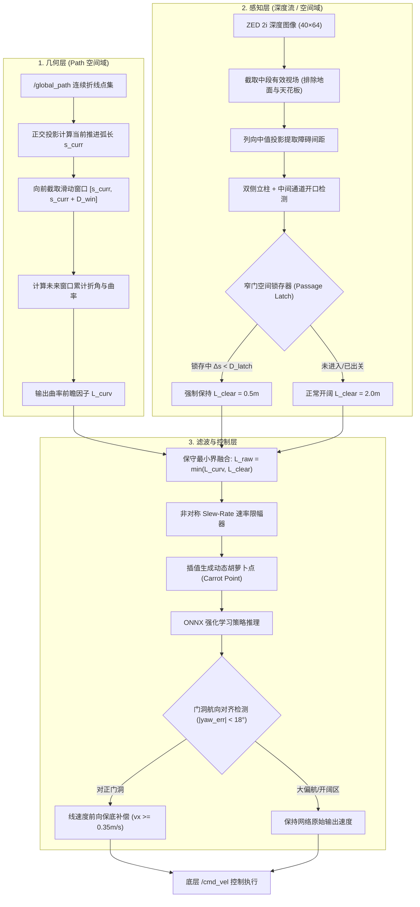

# Unitree Go2W 双因子自适应动态前瞻导航算法设计规范

> **文档定位**：系统化、高精度记录针对 Unitree Go2W 轮足机器人开发的**“路径前向滑动窗口曲率”与“局部通道净空感知”双因子融合自适应前瞻导航算法**（Dual-Factor Adaptive Lookahead Algorithm）。  
> **核心目标**：彻底解决狭窄通道（小门）穿行中的“隔墙指路”与“末端爬行”问题，攻克“直行后拐角进门”中的切角相撞与视界盲区，实现开阔区高速巡航与狭窄弯道自适应通行的有机统一，且**全算法自主计算、零依赖人工先验地图标注**。

---

## 目录
1. [核心物理矛盾与算法动机](#1-核心物理矛盾与算法动机)
2. [算法总体架构与数据流](#2-算法总体架构与数据流)
3. [模块一：基于 Path 前向滑动窗口的曲率自适应因子 $L_{\text{curv}}$](#3-模块一基于-path-前向滑动窗口的曲率自适应因子-l_textcurv)
4. [模块二：局部通道净空感知与空间迟滞锁存器 $L_{\text{clear}}$](#4-模块二局部通道净空感知与空间迟滞锁存器-l_textclear)
5. [模块三：非对称 Slew-Rate 限幅与双因子融合](#5-模块三非对称-slew-rate-限幅与双因子融合)
6. [模块四：航向对齐窄道前向推力补偿](#6-模块四航向对齐窄道前向推力补偿)
7. [算法参数全表与工程调优建议](#7-算法参数全表与工程调优建议)
8. [代码工程映射清单](#8-代码工程映射清单)
9. [实机测试记录与消融实验分析 (2026-11-06)](#9-实机测试记录与消融实验分析-2026-11-06)

---

## 1. 核心物理矛盾与算法动机

在端到端强化学习（SRU/LSTM）视觉避障与全局路径跟踪系统中，高层网络输入包含**机身体系下的单位目标向量与对数距离特征**：
$$o_{\text{target}} = \left[\frac{x_b}{d}, \frac{y_b}{d}, \frac{z_b}{d}, \ln(d + 1.0)\right], \quad d = \|[x_b, y_b, z_b]\|$$

固定前瞻距离机制在此架构下暴露出无法调和的两难困境：

```
                                  前瞻距离两难困境 (Dilemma)
                                              │
              ┌───────────────────────────────┴───────────────────────────────┐
              ▼                                                               ▼
   【大前瞻模式：L = 2.0m】                                        【小前瞻模式：L = 0.5m】
  优点：决策视界深远，提前平滑避让动态障碍，                      优点：胡萝卜点落在门缝正中央，
        线速度拉满 (0.8 ~ 1.0 m/s)。                                    目标向量直穿门洞，不隔墙指路。
  缺点：过窄门时目标穿透门框射入门后侧墙，                        缺点：ln(dist+1) 骤降引致速度衰减至 0.2m/s；
        诱发强烈碰撞惩罚，掉头逃逸拒进门。                              开阔区视距过窄，丧失动态避障反应距离。
```

进一步地，在真实物理世界中，机器人绝非总是正对小门。常见工况为**“直行一段距离后，直角转弯（右转/左转）穿过小门”**：
- **机身视角盲区**：在直行逼近拐弯时，机身正对走廊尽头，小门处在侧方视角边缘甚至完全在相机 FOV 之外。若只测机身正前净空，算法误以为前方空旷，保持 $2.0\text{m}$ 大前瞻高速前冲；
- **切内角相撞（Corner Cutting）**：大前瞻胡萝卜点跨过直角拐弯直接落在转弯后方，牵引机器狗走“割线（弦线）”，机身内侧直接刮蹭转角立柱；
- **门内出画失盲**：当狗刚刚跨入门框（距门 $0.2\text{m}$），两侧门框立柱从相机画面两侧出画，单帧感知容易误以为“已出开阔区”，瞬间拉大前瞻导致门内甩尾擦碰。

因此，算法必须具备**跨地图全自适应的几何前向预判**与**鲁棒的感知状态锁存能力**。

---

## 2. 算法总体架构与数据流

自适应算法采用模块化分层设计，其逻辑流图如下：



---

## 3. 模块一：基于 Path 前向滑动窗口的曲率自适应因子 $L_{\text{curv}}$

### 3.1 核心思想
传统曲率算法通常计算机器狗“当前所在单点”的曲率。这在高速导航中具有严重滞后性——当机器人走到拐角点时才发现曲率很大，但此时大前瞻点早已提前越过拐角穿入墙壁，无法阻止切角撞墙。

本算法提出**“前向探查滑动窗口”（Forward Sliding Window Analysis）**：无论机器狗当前身处何处，始终向前探查未来 $D_{\text{window}}$（默认 $1.5\text{m}$）路径段的几何形状。只要前方即将发生转折，**在进入拐弯前 $1.0\text{m}$ 就提前把前瞻平滑收紧**。

### 3.2 离散折线几何解析
设路径包含点序列 $P_0, P_1, \dots, P_N$，当前机器狗在路径上的正交投影弧长进度为 $s_{\text{curr}}$。
探查区间为 $[s_{\text{curr}}, s_{\text{target\_end}}]$，其中：
$$s_{\text{target\_end}} = s_{\text{curr}} + D_{\text{window}}$$

1. **区间覆盖与切向角提取**：
   遍历各线段 $\overline{P_i P_{i+1}}$（对应弧长区间 $[s_i, s_{i+1}]$），截取其与探查区间的交集：
   $$\Delta s_i = \max(0.0, \; \min(s_{i+1}, s_{\text{target\_end}}) - \max(s_i, s_{\text{curr}}))$$
   若 $\Delta s_i > 0$，提取该线段的平面切向航向角：
   $$\theta_i = \text{atan2}(P_{i+1, y} - P_{i, y}, \; P_{i+1, x} - P_{i, x})$$

2. **累计角变化量与极值评估**：
   计算窗口内连续线段之间的航向夹角差（规范化至 $[-\pi, \pi]$）：
   $$\delta\theta_i = (\theta_{i+1} - \theta_i + \pi) \pmod{2\pi} - \pi$$
   定义窗口内综合转向活跃度 $\Delta \Theta$：
   $$\Delta \Theta = \max\left( \sum_{i} |\delta\theta_i|, \; |\theta_{\text{last}} - \theta_{\text{first}}|, \; \max_i |\delta\theta_i| \right)$$

### 3.3 余弦平滑插值函数
设定转角下限阈值 $\theta_{\text{low}} = 15^\circ$（认为接近直行）与转角上限阈值 $\theta_{\text{high}} = 50^\circ$（认为属于急弯）。
曲率前瞻因子 $L_{\text{curv}}$ 通过余弦曲线平滑生成，确保导数连续无阶跃：

$$L_{\text{curv}} = \begin{cases}
L_{\max}, & \Delta \Theta \le \theta_{\text{low}} \\
L_{\min}, & \Delta \Theta \ge \theta_{\text{high}} \\
L_{\min} + (L_{\max} - L_{\min}) \cdot \frac{1 + \cos\left(\pi \cdot \frac{\Delta \Theta - \theta_{\text{low}}}{\theta_{\text{high}} - \theta_{\text{low}}}\right)}{2}, & \theta_{\text{low}} < \Delta \Theta < \theta_{\text{high}}
\end{cases}$$

> **工程效果**：当机器狗在直行走廊行进、距离右转小门尚有 $1.0\text{m}$ 时，探查窗口已将小门处 $90^\circ$ 直角弯计入 $\Delta \Theta$，前瞻由 $2.0\text{m}$ 提前下降至 $0.5\text{m} \sim 0.75\text{m}$。机器狗以紧凑前瞻贴紧圆弧转弯，**彻底避免以大前瞻切弦撞向门框内侧**。

---

## 4. 模块二：局部通道净空感知与空间迟滞锁存器 $L_{\text{clear}}$

### 4.1 深度图 ROI 截取与列向降维投影
输入为 ZED 2i 双目深度图像 $D \in \mathbb{R}^{H \times W}$（分辨率 $40 \times 64$）。
1. **剔除地平与天花板**：机器狗机身俯仰和路面凹凸会导致图像底部的地面在测距上很近；天花板灯具会产生高噪点。因此算法严格截取中间纵向区域：
   $$\text{ROI} = D[\lfloor 0.35H \rfloor : \lfloor 0.70H \rfloor, \; :]$$
2. **列中值投影（Column-wise Median Projection）**：
   对每一列像素沿垂直方向求中值（忽略无效测距 NaN/Inf），形成一维横向深度剖面向量 $d_{\text{col}} \in \mathbb{R}^W$：
   $$d_{\text{col}}[j] = \text{nanmedian}(\text{ROI}[:, j]), \quad j \in [0, W-1]$$

### 4.2 三区域门洞开口启发式分类
将视场均分为左分区（Left: $0 \sim \frac{W}{3}$）、中分区（Center: $\frac{W}{3} \sim \frac{2W}{3}$）与右分区（Right: $\frac{2W}{3} \sim W$）：
- **双侧近场立柱判据**：
  $$\text{LeftNear} = \min(d_{\text{col}}[\text{Left}]) < 1.4\text{m}, \quad \text{RightNear} = \min(d_{\text{col}}[\text{Right}]) < 1.4\text{m}$$
- **中央通道开阔判据**：
  $$d_{\text{center}} = \text{median}(d_{\text{col}}[\text{Center}])$$
  若中央深度明显深于两侧立柱（$d_{\text{center}} > \min(d_{\text{left}}, d_{\text{right}}) + 0.25\text{m}$）或中央为远端开阔平原（$d_{\text{center}} = 0.0$ / 超量程），则触发门洞判定：
  $$\text{IsNarrowDoor} = \text{True}, \quad W_{\text{clearance}} \approx 0.85\text{m}$$

### 4.3 空间迟滞锁存器（Passage Spatial Latch）
- **致命痛点规避**：当机器狗行进至门框前 $0.2\text{m}$ 时，两侧门框因视角扩展而移出相机横向画面（出画）。单帧感知此时测得全视野开阔，若无锁存，前瞻会在**跨入小门的瞬间突增为 $2.0\text{m}$**，引发门框撞击。
- **空间锁存机制**：
  1. 一旦检测到进入窄道（$\text{IsNarrowDoor} = \text{True}$），立即锁存当前沿线累积进度 $s_{\text{entry}} = s_{\text{curr}}$，并置标志位 $\text{in\_narrow} = \text{True}$；
  2. 机器狗向前推进过程中，持续跟踪已通过的物理弧长：
     $$\Delta s = s_{\text{curr}} - s_{\text{entry}}$$
  3. **只要 $\Delta s < D_{\text{latch}}$（默认 $1.2\text{m}$，大于车体长度的两倍），即便深度相机此时完全看不到立柱，算法也强制保持 $L_{\text{clear}} = L_{\min} = 0.5\text{m}$**；
  4. 唯有累计穿过 $1.2\text{m}$、整车完全脱离门套结构后，才安全释放锁存。

---

## 5. 模块三：非对称 Slew-Rate 限幅与双因子融合

### 5.1 保守融合准则（Min-Fusion）
曲率因子表征**轨迹转折压迫**，净空因子表征**物理环境压迫**。控制系统采取保守下界融合策略：
$$L_{\text{target}} = \min(L_{\text{curv}}, \; L_{\text{clear}})$$
- 只要前方有急弯，**或者**当前身处窄门，前瞻均果断压低到 $0.5\text{m}$；
- 只有既无急弯、又是大平原时，前瞻才允许放大至 $2.0\text{m}$。

### 5.2 非对称 Slew-Rate 限幅设计
若目标前瞻 $L_{\text{target}}$ 发生阶跃跳变，胡萝卜点将在全局路径上剧烈瞬移，导致策略输入的目标向量夹角产生突跃，引发机身转向甩尾。
算法引入**非对称变化率限幅器（Asymmetric Slew-Rate Limiter）**：

$$\Delta t = \text{clamp}(t_{\text{curr}} - t_{\text{last}}, \; 0.001\text{s}, \; 0.5\text{s})$$

$$L_t = \begin{cases}
\max(L_{\text{target}}, \; L_{t-1} - R_{\text{down}} \cdot \Delta t), & L_{\text{target}} < L_{t-1} \quad \text{(快速收缩响应)} \\
\min(L_{\text{target}}, \; L_{t-1} + R_{\text{up}} \cdot \Delta t), & L_{\text{target}} > L_{t-1} \quad \text{(平缓恢复提速)}
\end{cases}$$

- **收缩速率**：$R_{\text{down}} = 2.5\text{ m/s}$。从 $2.0\text{m}$ 降至 $0.5\text{m}$ 仅需 $0.6\text{s}$，能敏捷化解突发弯道与近身障碍；
- **回弹速率**：$R_{\text{up}} = 0.6\text{ m/s}$。出关后从 $0.5\text{m}$ 缓慢平滑升至 $2.0\text{m}$ 耗时约 $2.5\text{s}$，保证机器狗在出关加速时平稳加速，无前倾冲撞。

---

## 6. 模块四：航向对齐窄道前向推力补偿

### 6.1 解决 $L=0.5\text{m}$ 时的终末减速爬行
由于策略网络在训练时学习了减速停车特征：
$$v_x \propto \ln(d + 1.0)$$
当 $L=0.5\text{m}$ 时，$\ln(1.5) \approx 0.405$，网络自然输出爬行速度（$0.15 \sim 0.25\text{m/s}$）。

### 6.2 动力学补偿判据
在控制器的命令发布阶段（[`rl_nav_controller_adaptive.py:L1248-L1258`](file:///home/yichangfeng/sru-navigation-learning/rl_nav_controller_adaptive.py#L1248-L1258)）：
1. 检查机器人是否处于窄门穿行锁存状态：$\text{in\_narrow} == \text{True}$；
2. 提取机身体系下的目标向量横纵分量 $[t_{x,b}, t_{y,b}]$，计算当前航向对准偏差：
   $$\text{yaw\_err} = \text{atan2}(t_{y,b}, \; t_{x,b})$$
3. **安全补偿条件**：
   当 $|\text{yaw\_err}| < 18^\circ$（约 $0.31\text{ rad}$）时，证实**机头已精准正对门缝，前进不会蹭墙**；
   若此时网络输出的未滤波线速度 $v_x < v_{\text{boost}}$（默认 $0.35\text{m/s}$），则**强制将基底线速度提升至 $v_{\text{boost}}$**：
   $$v_{x, \text{cmd}} = \max(v_{x, \text{cmd}}, \; v_{\text{boost}})$$

> **实机效果**：机器狗在拐弯后机头一旦对正小门，不会在门前迟疑爬行或卡顿，而是以干脆、稳健的 $0.35\text{m/s} \sim 0.45\text{m/s}$ 顺畅穿门而过。

---

## 7. 算法参数全表与工程调优建议

| 参数名称 | ROS 2 参数名 / 变量名 | 默认值 | 单位 | 物理含义与调优准则 |
|:---|:---|:---:|:---:|:---|
| **前瞻下界** | `lookahead_min` | `0.5` | $\text{m}$ | 窄门与急弯前瞻。过大易穿墙，过小易造成速度损失。建议范围 $0.4 \sim 0.6\text{m}$。 |
| **前瞻上界** | `lookahead_max` | `2.0` | $\text{m}$ | 开阔区巡航前瞻。决定了平原最高航速与预判视界。建议范围 $1.8 \sim 2.5\text{m}$。 |
| **滑动探查窗口** | `adaptive_window_dist` | `1.5` | $\text{m}$ | 向前预查路径弯曲的距离。若直角弯前减速过晚，增大此值；若转弯过早收缩，减小此值。 |
| **微转折角阈值** | `turn_angle_low_deg` | `15.0` | 度 | 低于此转角认为处于直线直道，前瞻保持 $L_{\max}$。 |
| **急转折角阈值** | `turn_angle_high_deg` | `50.0` | 度 | 超过此转角认为存在直角或急弯，前瞻直接降至 $L_{\min}$。 |
| **收缩变化率** | `slew_rate_decrease` | `2.5` | $\text{m/s}$ | 前瞻从大到小的最大变动速率。要求快速响应，一般在 $2.0 \sim 3.0\text{m/s}$。 |
| **释放变化率** | `slew_rate_increase` | `0.6` | $\text{m/s}$ | 出关或拐弯后前瞻从小到大的恢复速率。要求平缓，一般在 $0.4 \sim 0.8\text{m/s}$。 |
| **窄道锁存距离** | `passage_latch_dist` | `1.2` | $\text{m}$ | 进入窄门后的防出画锁存空间跨度。应大于车体对角线长度的 1.5 倍。 |
| **过门推力补偿** | `door_speed_boost` | `0.35` | $\text{m/s}$ | 门内航向对齐后的保底前向速度。过大进门冲撞，过小蠕动，建议 $0.3 \sim 0.4\text{m/s}$。 |

---

## 8. 代码工程映射清单

| 算法功能块 | 实现文件 | 核心函数 / 类 |
|:---|:---|:---|
| 折线投影与前瞻提取基类 | [`adaptive_path_tracker.py`](file:///home/yichangfeng/sru-navigation-learning/adaptive_path_tracker.py#L38-L188) | `PathSegmentTracker.update_progress`<br/>`PathSegmentTracker.get_lookahead_point` |
| 滑动窗口曲率自适应因子 | [`adaptive_path_tracker.py`](file:///home/yichangfeng/sru-navigation-learning/adaptive_path_tracker.py#L248-L300) | `AdaptivePathSegmentTracker.compute_path_curvature_lookahead` |
| 局部净空与空间锁存器 | [`adaptive_path_tracker.py`](file:///home/yichangfeng/sru-navigation-learning/adaptive_path_tracker.py#L302-L352) | `AdaptivePathSegmentTracker.evaluate_passage_clearance` |
| Slew-Rate 限幅与综合插值 | [`adaptive_path_tracker.py`](file:///home/yichangfeng/sru-navigation-learning/adaptive_path_tracker.py#L354-L408) | `AdaptivePathSegmentTracker.get_adaptive_lookahead_point` |
| 自适应 ROS 2 控制器主节点 | [`rl_nav_controller_adaptive.py`](file:///home/yichangfeng/sru-navigation-learning/rl_nav_controller_adaptive.py#L1160-L1180) | `NavigationPolicyNode.generate_cmd_vel` |
| 门洞航向对齐推力补偿 | [`rl_nav_controller_adaptive.py`](file:///home/yichangfeng/sru-navigation-learning/rl_nav_controller_adaptive.py#L1250-L1260) | `NavigationPolicyNode.generate_cmd_vel` |
| 算法离线场景仿真验证套件 | [`scripts/test_adaptive_lookahead.py`](file:///home/yichangfeng/sru-navigation-learning/scripts/test_adaptive_lookahead.py#L30-L170) | `test_straight_then_90deg_right_turn`<br/>`test_narrow_passage_and_spatial_latching` |

---

## 9. 实机测试记录与消融实验分析 (2026-11-06)

* **记录时间**：`2026-11-06 18:02:09`
* **测试平台**：Unitree Go2W（实机硬件部署）
* **测试路段与工况**：**当前位置至电梯间路段**（涵盖长直道走廊、直角/转弯穿窄门、下行长楼梯复杂混合地形）
* **测试模式**：消融对比测试模式（`curv-only` 路径曲率单因子 vs `door-only` 视觉净空单因子）

### 9.1 实测现象与消融对比结论

| 测试模式 | 启动方式 | 直路避障与巡航表现 | 转弯过窄门表现 | 长楼梯通行表现 |
|:---|:---|:---|:---|:---|
| **`curv-only`**<br/>(仅保留 Path 曲率转弯判断) | `./start_nav_adaptive.sh --curv-only` | **表现更优**：开阔直道前瞻稳定在 $2.0\text{m}$，视界深远；彻底消除了视觉噪点/走廊立柱导致的假门洞误锁存与突发减速。 | **稍有影响，易碰窄门**：转弯过窄门时容易剐蹭门框，需进一步审查曲率与前瞻收缩判定逻辑。 | **无法通行**：遇长阶梯无法顺利向下行进。 |
| **`door-only`**<br/>(仅保留视觉窄门净空感知) | `./start_nav_adaptive.sh --door-only` | **难以有效避障**：视觉极易将走廊侧墙、普通立柱或地面反光误触发为“假门洞/通道收敛”，导致前瞻频繁跌至 $0.5\text{m}$ 并陷入 $1.2\text{m}$ 锁存，决策视界过窄，避障不及。 | **进门能感知但稳定性差**：正对门洞时能收缩前瞻，但受光照、相机视场与角度漂移影响波动大。 | **无法通行**：遇长阶梯无法顺利向下行进。 |

---

### 9.2 关键根因剖析与后续迭代待办（TODO）

#### 1. 关于 `curv-only` 模式下“转弯过窄门易碰门框”的判定逻辑排查
* **现象归因**：
  - **窗口收缩滞后或恢复过快**：当前滑动窗口设为 $D_{\text{win}} = 1.5\text{m}$。转弯进门时，当机身刚转过直角弯、机头进入门缝瞬间，未来 $1.5\text{m}$ 路径已变为房间内直线，导致窗口有效折角 $\Delta \Theta$ 骤降，前瞻点开始以 $R_{\text{up}} = 0.6\text{m/s}$ 回弹增大，拉长的前瞻在门套后方再次形成“割线”，牵引机身后侧刮蹭门框；
  - **缺乏物理空间贴合先验**：纯折线几何无法感知机器人与门框左右两柱的实际毫米级物理净距，当全局规划折线与物理门缝中心存在轻微横向偏移（$5\sim 10\text{cm}$）时，纯几何跟踪缺乏侧向柔顺避让。
* **排查与改进方向（TODO）**：
  - [ ] 审查 `compute_path_curvature_lookahead` 中转角平滑余弦映射区间的上下限（当前为 $15^\circ \sim 55^\circ$），确认急弯触发前瞻收敛的时机；
  - [ ] 针对“转弯后立即过门”的工况，增加**出弯后的前瞻恢复延时或距离滞后**（过弯后持续保持小前瞻穿门一定弧长再恢复）；
  - [ ] 校验全局规划器给出的门洞折线是否精准穿过门套几何中轴。

#### 2. 关于“直路避障效果更好”与“视觉误触发”的本质认知
* 实测证实了此前工程判断：**视觉单帧投影法在直道存在结构性缺陷**，将走廊边缘误判为窄门是导致直路避障能力崩溃的元凶；因此直道巡航应果断以纯几何/开阔大前瞻（$2.0\text{m}$）为主导。

#### 3. 关于“长楼梯地形仍无法通行”的深层原因
* **深度感知视角与几何截断**：当前算法为了过滤地面起伏噪声，截取了深度图纵向 $35\% \sim 70\%$ 的 ROI。当下长楼梯时，阶梯向下断崖式跌落，该截取区域内大量测距超出有效范围或返回无限远（Inf/NaN），导致前向深度感知“失明”；
* **高程落差与步态适应**：当前高层规划与前瞻提取主要工作在 2D 平面投影弧长上，未针对陡峭 3D 楼梯高程阶梯建模；同时底层的强化学习策略网络主要基于平面及微起伏地形训练，面对长下行阶梯产生俯仰角突变并诱发策略失稳拒止。下楼梯工况需要专门的阶梯感知与特化步态/控制策略接管。
