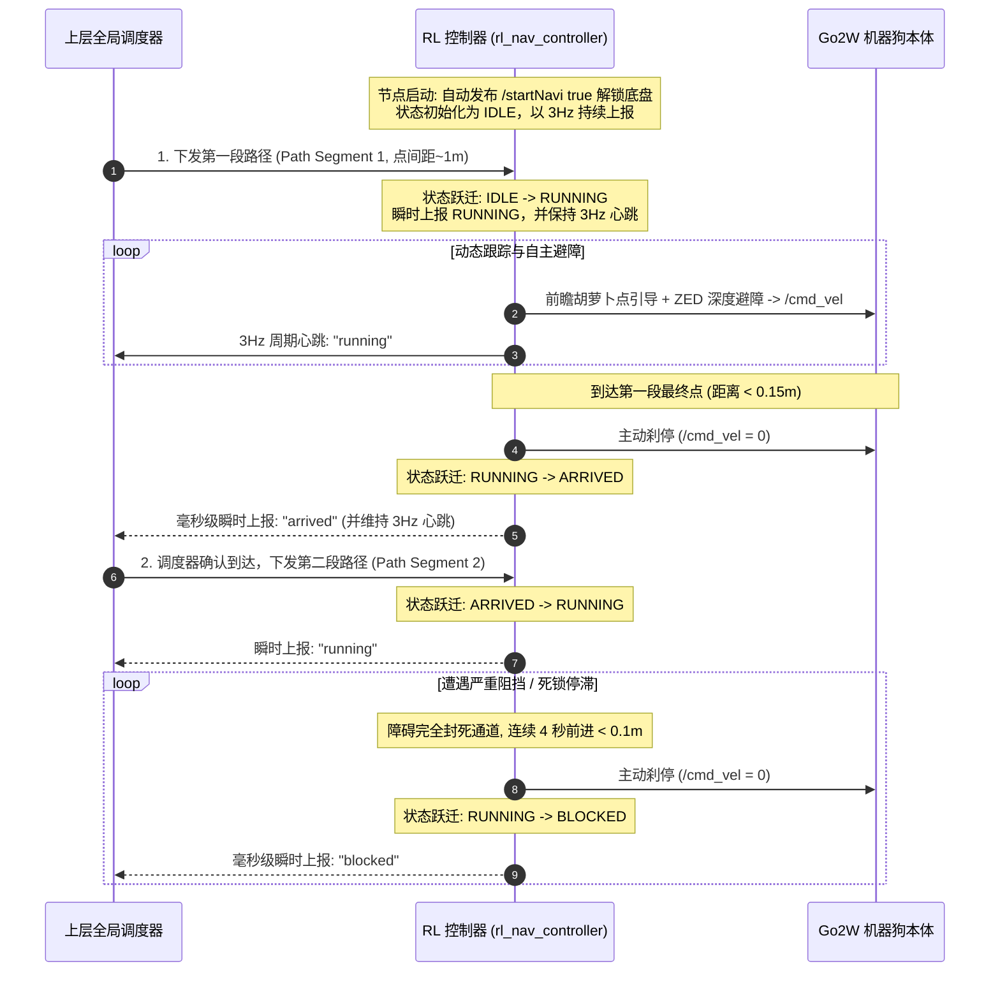
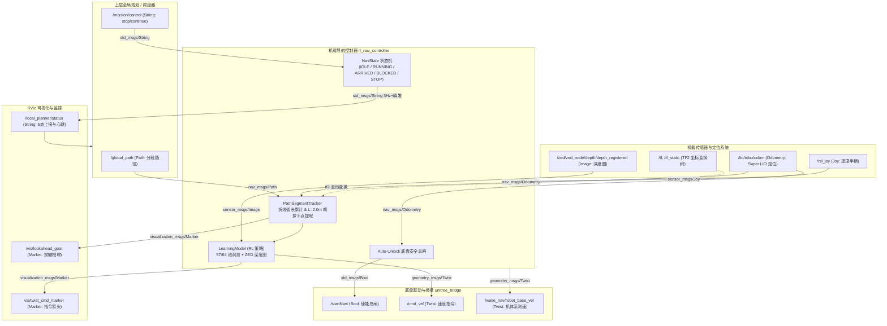
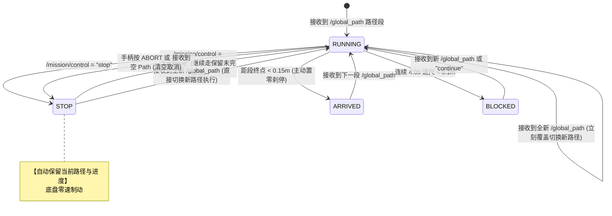
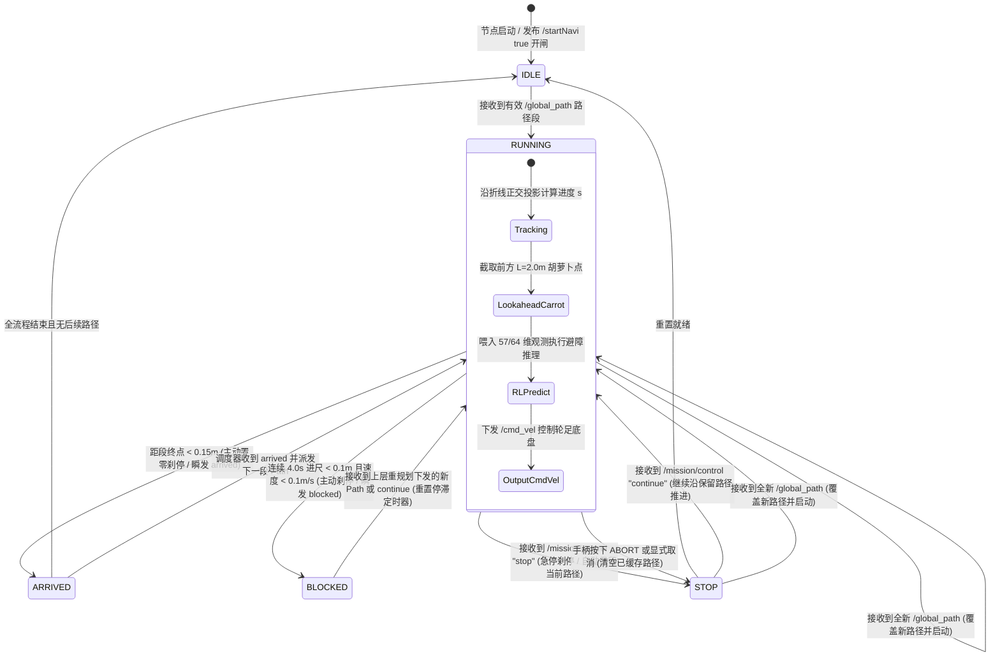

# Unitree Go2W 全局导航接入与避障跟踪技术方案与对齐规范 (最新版)

> **文档版本**：v1.2 (实机工程实现落地与接口变量规范版)  
> **更新时间**：2026-10-30  
> **代码落地路径**：`go2w_robot_ref/sru_ws/src/sru-robot-deployment/rl_nav_controller`  
> **适用机型**：Unitree Go2W 轮足机器人 (机载 Jetson Orin DevKit, ROS 2 Humble)  
> **系统层级**：上层全局规划调度层 $\longleftrightarrow$ 机载 RL 局部避障控制器 (`rl_nav_controller`) $\longleftrightarrow$ 宇树底盘桥接 (`unitree_bridge`)

---

## 1. 业务交互模式：分段路径推进机制

根据最新业务规划，上层调度与下层执行之间采用 **“分段下发、到点反馈、逐段推进”** 的交互闭环：



### 核心推进流程：
1. **单段下发**：上层规划器每次下发一段局域 Path（由一系列点组成，点间距约 1m）；
2. **平滑跟障**：下层利用动态前瞻胡萝卜点在段内平滑巡航，遇到障碍物由 RL 策略自主绕行并自动收敛回本段路径；
3. **到点反馈**：当且仅当机器狗到达该段 Path 的**最终目标点**时，下层主动原地刹停，**立即瞬间上报状态**，同时保持低频心跳；
4. **推进下一段**：上层接收到本段到点反馈后，结合全局最新全局态势，下发下一段 Path。

---

## 2. 状态机设计与上报机制 (Multi-State & Standard JSON Reporting)

### 2.1 状态枚举与 JSON 格式定义 (Standard JSON Status)
状态机严格对齐 `local_planner_status_diagram (1).html` 标准规范，所有上报通过 `/local_planner/status` 以 JSON 字符串发布：
`{"state": "<state>", "msgs": <array>}`

各状态语义与字段定义如下（默认 `msgs` 为 JSON 原生数组：非 error 时为 `[]`，error 时为 `["zed_camera_lost"]`）：

| 状态值 (`state`) | 附带消息 (`msgs`) | 状态语义 | 触发条件与恢复策略 | 机体动作 |
| :--- | :--- | :--- | :--- | :--- |
| **`"idle"`** | `[]` (空数组) | **空闲就绪** | 节点启动就绪、或已完成全流程且无路径任务。收到新路径直接跃迁至 `running`。 | 原地站立静止，等待新路径。 |
| **`"running"`** | `[]` (空数组) | **任务执行中** | 收到有效全局 Path、或在 `stopped` / `failed` 状态下收到 `resume` 指令恢复执行。 | 按前瞻胡萝卜点推进，ZED 深度自主避障。 |
| **`"goal_reached"`** | `[]` (空数组) | **本段路径已到达** | 机器狗距离当前段 Path 的**最终目标点** $< 0.10\text{m} \sim 0.15\text{m}$。 | 主动刹停置零速度，清除已完成目标，瞬发上报后立刻变至 `idle`，构成单向闭环三角（`idle -> running -> goal_reached -> idle`）。 |
| **`"failed"`** | `[]` (空数组) | **规划受阻/死锁停滞** | 前方被障碍物完全封堵，连续停滞超时（默认 $>4.0\text{s}$）。**可恢复**：上层重发 `/global_path` 或发送 `resume` 即可脱困继续。 | 主动减速刹停，避免顶撞障碍物，等待上层重规划。 |
| **`"error"`** | `["zed_camera_lost"]` | **传感器/硬件致命异常** | ZED 相机深度帧连续中断超时（$>2.0\text{s}$）。**不可自动恢复**：此时下发新路径会被主动拒绝，需检查硬件连线或重启终端。 | 主动减速刹停，拒绝接收新路径，等待重启/硬件恢复。 |
| **`"stopped"`** | `[]` (空数组) | **停止/暂停** | 收到上层指令 (`/mission/control: "pause"` 或 `"stop"`)、现场手柄按 ABORT、或收到空路径。 | 原地紧急制动刹停，**自动在内存中保留未跑完路径**。**停后收新路径仍保持 stopped**（仅更新内存路径），**只有收到 `"resume"` 才会重新启动**（跟随新路径或走完旧路径）。 |

> **标准上报格式示例**（直接对应 `local_planner_status_diagram (1).html`）：
> - 正常行走：`{"state":"running","msgs":[]}`
> - 本段到达：`{"state":"goal_reached","msgs":[]}`
> - 遇阻死锁：`{"state":"failed","msgs":[]}`
> - 相机掉线：`{"state":"error","msgs":["zed_camera_lost"]}`
>
> **参数化兼容模式**：控制器亦支持通过 `--status-msgs-format` 切换为 `string_brackets`（`"[]"` 与 `'["..."]'`）或 `empty_string`（`""`）。接收端工具对各种形态均实现无缝容错解析。

> **向后兼容别名**：代码内部 `NavState` 保留 `ARRIVED="goal_reached"`, `BLOCKED="failed"`, `STOP="stopped"`, `PAUSED="stopped"` 别名映射。

### 2.2 上报通信策略：1Hz 周期心跳 + 关键事件毫秒级瞬发 + 单向闭环三角
* **通信 QoS 配置**：
  * `/local_planner/status` 采用 **`Reliability: RELIABLE`** 与 **`Durability: TRANSIENT_LOCAL`** (depth=10)，确保状态瞬发与突发切换均完整推入队列；
* **低频周期心跳（1Hz）**：
  * 若无状态切换，以 **1Hz** 频率周期性广播当前 JSON 状态；
  * 特殊规则：到达状态 (`"goal_reached"`) 在到点时瞬发上报一次后立刻变至 `idle`；在 `idle` 下以 1Hz 心跳广播并持续监听新路径，一旦收到新路径直接跃迁至 `running`；
* **事件驱动瞬发（Event-Triggered Immediate Dispatch）**：
  * 在状态发生跃迁的**当个控制循环瞬时（毫秒级）**，立即调用发布器推入 ROS 2 中间件，包括：
    1. 检测到进入最终点 $<0.15\text{m}$ 的瞬间 $\rightarrow$ 立即发布 `{"state":"goal_reached","msgs":[]}` 并立刻变至 `idle`；
    2. 进入 `idle` 后以 1Hz 广播心跳，持续监测新路径；
    3. 检测到停滞超时的瞬间 $\rightarrow$ 立即发布 `{"state":"failed","msgs":[]}`；
    4. 检测到相机掉线超时的瞬间 $\rightarrow$ 立即发布 `{"state":"error","msgs":["zed_camera_lost"]}`；
    5. 收到 `/mission/control: "pause"` 或 `"stop"` 的瞬间 $\rightarrow$ 立即发布 `{"state":"stopped","msgs":[]}`；
    6. 处于 `stopped` 下收到新路径 $\rightarrow$ 仅更新内存路径，保持 `stopped` 且不自启；
    7. 收到 `/mission/control: "resume"` 或 `"continue"` 或在非 stopped 状态下收到新路径启动的瞬间 $\rightarrow$ 立即发布 `{"state":"running","msgs":[]}`。

### 2.3 停滞遇阻判定机理（Blocked Detection）
* **监控指标**：
  * 沿路径累计推进弧长增量 $\Delta s$；
  * 机器狗物理地面测速 $v_{real} = \sqrt{v_x^2 + v_y^2}$；
* **判定逻辑**：
  * 若当前状态处于 `RUNNING`，但由于前方障碍物过近（如 $<0.4\text{m}$）导致策略输出被安全抑制，连续 **$4.0\text{s}$（可配置参数）** 内满足 $\Delta s < 0.1\text{m}$ 且 $v_{real} < 0.1\text{m/s}$；
  * 触发 `FAILED` 状态，将输出速度强制置零，上报 `{"state":"failed","msgs":[]}`，防止机器狗死磕障碍物，等待上层全局重规划（重发新路径或发送 resume 即可恢复）。

---

---

## 3. 全系统话题发布与订阅完整技术规格书 (Complete Pub/Sub Interface Specification)

为便于与**上层规划调度组**、**SLAM定位建图组**以及**底盘硬件组**进行技术对接与标准对齐，下表和图表详尽列出了 `rl_nav_controller` 导航系统涉及的所有话题、通信方向、数据结构、字段定义、控制语义及默认配置参数。

### 3.1 总体通信拓扑架构与数据流图



---

### 3.2 接口分类一：上层规划调度对接接口 (Upper-Layer Interface - 核心重点)

此分类定义上层全局调度器与机载局部避障控制器之间的全部交互接口：

| 话题名称 (Topic) | 通信方向 | ROS 2 消息类型 | 频率 / 触发机制 | 对应的节点参数 (Parameter) | 字段定义与控制语义 |
| :--- | :---: | :--- | :--- | :--- | :--- |
| **`/global_path`** | **上层 $\rightarrow$ 控制器**<br/>(控制器订阅) | `nav_msgs/msg/Path` | 每次下发一段局域路径时发布一次 | `path_topic`<br/>(默认: `"/global_path"`) | **分段全局路径输入**。<br/>- `header.frame_id`: 坐标系（推荐 `"world"` 或 `"map"`）；<br/>- `header.stamp`: 生成时间戳；<br/>- `poses`: 散点列表，每个点为 `geometry_msgs/msg/PoseStamped`：<br/>  - `pose.position.x/y/z`: 三维坐标（单位：米）；<br/>  - `pose.orientation`: 末点姿态四元数（最后一点若包含朝向要求则填入有效四元数，否则控制器沿路径切向自然停机）。<br/>- **路径覆盖规则**：任何时刻（包括推进中或 `STOP` 停顿时）下发新路径，控制器**立即切换至新路径**执行。 |
| **`/local_planner/status`** | **控制器 $\rightarrow$ 上层**<br/>(控制器发布) | `std_msgs/msg/String` | **3Hz 固定周期心跳**<br/>+<br/>**状态跃迁毫秒级瞬发** | `status_topic`<br/>(默认: `"/local_planner/status"`) | **多状态生命周期上报 (5态)**。<br/>数据内容为字符串 (`msg.data`)，上层据此执行逐段推进判断：<br/>- `"idle"`: 节点空闲，等待新路径；<br/>- `"running"`: 正在沿路径推进或绕障；<br/>- `"arrived"`: 到达本段终点（$< 0.1\text{m} \sim 0.15\text{m}$），速度已主动刹停，**提示上层立刻派发下一段**；<br/>- `"blocked"`: 前方封死连续 4.0s 进尺 $< 0.1\text{m}$，**提示上层重规划**；<br/>- `"stop"`: 停止/暂停状态，底盘主动刹停，已自动保留当前路径。 |
| **`/mission/control`** | **上层 $\rightarrow$ 控制器**<br/>(控制器订阅) | `std_msgs/msg/String` | 事件触发（可选） | `stop_topic`<br/>(默认: `"/mission/control"`) | **任务启停控制指令**。<br/>数据内容为控制字符串 (`msg.data`)：<br/>- `"stop"`: 停止指令。底盘主动制动刹停（速度置零），状态变更为 `stop`，**系统默认自动保留当前未跑完的路径与当前进度**；<br/>- `"continue"`: 继续推进指令。状态变更为 `running`，从当前位置**继续沿保留路径无缝推进**。 |

> [!IMPORTANT]
> **关键认知纠偏说明（无需上层发 `running`）**：
> 上层只需向 `/global_path` 下发路径。控制器收到路径后，**下层控制器自己会把状态跃迁为 `running` 并通过 `/local_planner/status` 上报**！
> 上层**不需要、也不能**发布名为 `running` 的话题。上层的正确逻辑是**单向监听 `/local_planner/status`**：
> - 监听到 `arrived` $\rightarrow$ 立即下发第 2 段 Path；
> - 监听到 `blocked` $\rightarrow$ 触发全局绕路重规划；
> - 监听到 `stop` $\rightarrow$ 处于暂停/停止状态；需要继续时发送 `/mission/control: "continue"`，或直接发送新 `/global_path` 覆盖执行。

#### 3.2.1 统一 STOP 状态与路径自动保留/覆盖流转机理 (Unified STOP & Path Retention/Override Flow)

为了简化系统逻辑，下层**取消了原先 `paused` 与 `stop` 的多余区分，统一整合为 `stop`**：

1. **自动保留当前路径（Path Retention by Default）**：
   - 当上层发布 `/mission/control: "stop"` 时，控制器执行紧急主动制动（速度置零），进入 `stop` 状态；
   - 内部路径追踪器（`path_tracker`）**默认完整保留未跑完路径和进度弧长 $s$**，不予清除；
   - 后续上层只要发送 `/mission/control: "continue"`，状态自动恢复为 `running`，机器狗立刻从暂停点无缝继续跑完剩余路径。
2. **接收新路径自动覆盖（New Path Preemption & Override）**：
   - 无论机器人当前处于 `running` 推进中、还是处于 `stop` 停止中、亦或是 `blocked` 停滞中；
   - 一旦上层下发了新的 `/global_path`，控制器**无条件优先以最新路径为准**：
     - 清除旧路径；
     - 载入新路径并重置进度（$s = 0$）与停滞探测器；
     - 状态自动跃迁为 `running` 开始推进。
3. **彻底取消任务（Explicit Cancel）**：
   - 若现场手柄按下 ABORT 紧急取消键，或上层下发**空路径** (`Path(poses=[])`)，控制器将彻底清空路径缓存，刹停并保持在 `stop` 状态。



---

### 3.3 接口分类二：底盘驱动与硬件网关接口 (Chassis Actuation Interface)

此分类定义控制器与机载宇树底盘桥接驱动（`unitree_bridge`）之间的接口：

| 话题名称 (Topic) | 通信方向 | ROS 2 消息类型 | 频率 | 对应的节点参数 (Parameter) | 控制语义与保护机制 |
| :--- | :---: | :--- | :--- | :--- | :--- |
| **`/startNavi`** | **控制器 $\rightarrow$ 底盘桥**<br/>(控制器发布) | `std_msgs/msg/Bool` | 事件触发 | `start_navi_topic` (默认: `"/startNavi"`)<br/>`auto_unlock_bridge` (默认: `true`) | **底盘安全总闸开/闭**。<br/>- `data: true`: 开闸使能运动。控制器收到第 1 帧有效雷达里程计（`/lio/robo/odom`）后**全自动发布 `true` 解锁**，无需人工手动开闸；<br/>- `data: false`: 节点退出、异常中断或按 Ctrl+C 时**安全发布 `false` 锁死底盘**。 |
| **`/cmd_vel`**<br/>*(兼旧版 `/path_manager/path_manager_ros/nav_vel`)* | **控制器 $\rightarrow$ 底盘桥**<br/>(控制器发布) | `geometry_msgs/msg/Twist` | 10Hz ~ 15Hz (与策略同步) | `cmd_vel_topic` (默认: `"/cmd_vel"`) | **轮足底盘运动速度指令**。<br/>- `linear.x`: 前进线速度，范围 $[-1.0, 1.5]\text{ m/s}$；<br/>- `linear.y`: 横向侧移线速度，范围 $[-0.6, 0.6]\text{ m/s}$；<br/>- `angular.z`: 原地转向角速度，范围 $[-1.5, 1.5]\text{ rad/s}$；<br/>- `linear.z = angular.x = angular.y = 0.0`。<br/>*注：在 STOP, ARRIVED, BLOCKED 状态下，控制器自动主动发布零速制动。* |
| **`/walle_nav/robot_base_vel`** | **控制器 $\rightarrow$ 系统**<br/>(控制器发布) | `geometry_msgs/msg/Twist` | 随里程计触发 (~20Hz) | - | **机体坐标系（Base Frame）对地测速反馈**。<br/>将雷达里程计在世界系下的三维速度，利用四元数动态转换到当前机器狗机体坐标系下发布，供内部状态观测和外部监控。 |

---

### 3.4 接口分类三：传感器感知与定位输入接口 (Sensors & Localization Interface)

控制器进行强化学习避障推理与折线前瞻追踪所必须依赖的硬件传感器输入：

| 话题名称 (Topic) | 通信方向 | ROS 2 消息类型 | 频率 | 来源硬件 / 算法 | 字段要求与作用说明 |
| :--- | :---: | :--- | :--- | :--- | :--- |
| **`/lio/robo/odom`**<br/>*(映射前: `/dlio/odom_node/odom`)* | **SLAM $\rightarrow$ 控制器**<br/>(控制器订阅) | `nav_msgs/msg/Odometry` | 10Hz ~ 50Hz | Livox MID-360 雷达 + Super LIO 重定位算法 | **高频机身物理位姿与测速输入**。<br/>- `pose.pose.position`: 机器狗在世界坐标系中的实时坐标 $[x, y, z]$；<br/>- `pose.pose.orientation`: 机器狗空间姿态四元数 $[w, x, y, z]$；<br/>- `twist.twist`: 机器狗对地空间线速度与角速度。<br/>*若未收到本话题，控制器将保持在 Waiting for robot position 状态，底盘不开闸。* |
| **`/zed/zed_node/depth/depth_registered`** | **相机 $\rightarrow$ 控制器**<br/>(控制器订阅) | `sensor_msgs/msg/Image` | 15Hz (恒定) | ZED 2i 双目立体深度相机 | **局部环境深度图输入**。<br/>- 编码格式: `32FC1` (单通道 32 位浮点型，每个像素值为实际距离，单位：米)；<br/>- 分辨率: 经轻量化配置缩放后输入 VAE 编码器（有效深度感知范围: $0.25\text{m} \sim 10.0\text{m}$）。 |
| **`/tf` & `/tf_static`** | **系统 TF 树 $\rightarrow$ 控制器**<br/>(控制器监听) | `tf2_msgs/msg/TFMessage` | 持续广播 | `tf2_ros` 坐标变换树 | **坐标系自动对齐与标定**。<br/>- 相机水平外参: `base_link` $\rightarrow$ `zed_camera_link` ($[0.257, 0.0, 0.28, 0, 0, 0]$)；<br/>- 地图变换: 若 Path 带有外层坐标系（如 `map`），自动查询 `target_frame <- source_frame` 进行三维坐标转换。 |
| **`/rsl_joy`** | **手柄 $\rightarrow$ 控制器**<br/>(控制器订阅) | `sensor_msgs/msg/Joy` | 50Hz | 机载蓝牙 / 2.4G 遥控手柄 | **安全人工接管与冗余微调**。<br/>手柄推杆可直接叠加微调速度，手柄指定按键可随时执行紧急 ABORT 切断。 |

---

### 3.5 接口分类四：RViz 可视化与算法调试接口 (Visualization & Diagnostics)

用于开发人员通过 NoMachine 或远程 RViz 实时观测算法运行细节：

| 话题名称 (Topic) | 通信方向 | ROS 2 消息类型 | 频率 | 说明 |
| :--- | :---: | :--- | :--- | :--- |
| **`/vis/lookahead_goal`** | 控制器发布 | `visualization_msgs/msg/Marker` | 5Hz | **动态前瞻胡萝卜点标记**。亮橙色立体球体（直径 0.4m），直观指示 RL 网络当前正在追踪的前方引导点位置。 |
| **`vis/twist_cmd_marker`** | 控制器发布 | `visualization_msgs/msg/Marker` | 10Hz | 当前速度控制指令矢量箭头。 |
| **`vis/goal_vector_marker`** | 控制器发布 | `visualization_msgs/msg/Marker` | 10Hz | 目标点相对机身位置的绿色指示矢量。 |
| **`vis/recorded_waypoints_marker`** | 控制器发布 | `visualization_msgs/msg/Marker` | 1Hz | 录制航点与历史轨迹球体标记。 |
| **`/goal_pose`** | 控制器订阅/发布 | `geometry_msgs/msg/PoseStamped` | 事件触发 | 兼容老版本单目标点输入与 RViz 2D Nav Goal 目标交互。 |

---

## 4. 坐标系与 TF 适配方案 (待查明处理规范)

> [!WARNING]
> **坐标系当前状态：上层规划器发布的 Path 坐标系目前“待查明 (TBD)”**。

为了在坐标系未明的情况下保证系统稳健运行，下层控制器采取如下防错与自适应策略：

```mermaid
flowchart TD
    RecvPath[接收到 /global_path] --> CheckFrame{检查 Path.header.frame_id}
    
    CheckFrame -->|匹配机载里程计 (world / map)| DirectAccept[直接接收并转换为局部目标]
    
    CheckFrame -->|未指定或为空 ''| FallbackAccept[告警提示: 默认绑定至机载当前里程计系]
    
    CheckFrame -->|指定了外层未知 frame_id| TFLookup{查询 TF 树是否存在变换<br/>lookupTransform}
    
    TFLookup -->|存在 TF 变换| TransformPath[通过 tf2 将路径点坐标转换至机载 world 系]
    TFLookup -->|不存在 TF 变换| FatalError[打印高亮红色告警并在 /local_planner/status 上报 blocked/error]
```

### 坐标系对齐策略说明：
1. **参数化指定**：新增参数 `path_frame_id`（默认值设为 `""`，即自动匹配机载 SLAM 的 frame）；
2. **TF2 监听器集成**：在 `rl_nav_controller` 内部挂载 `tf2_ros.Buffer` 和 `TransformListener`。若上层下发的是 `"map"` 而机载是 `"world"`，且系统中广播了 `map -> world` 的 TF，控制器自动完成坐标变换；
3. **安全自检**：若上层下发的点坐标首点与当前机器狗物理坐标偏差超过 $2.5\text{m}$，控制器将抛出异常预警，防止坐标系错位导致底盘暴冲。

---

## 5. 底盘自动化解锁与免配置启动设计

### 5.1 背景问题
以往调试时，终端拉起导航策略后，必须人为在新终端敲命令：
```bash
ros2 topic pub /startNavi std_msgs/msg/Bool "{data: true}" --once
```
若遗漏敲该命令，底盘硬件网关 `unitree_bridge` 会阻断一切 `/cmd_vel`，导致策略有输出但机身纹丝不动。

### 5.2 解决方案：节点初始化自动开闸
在 `rl_nav_controller` 节点（及启动脚本）内部集成自动开闸逻辑：
1. **开机自投使能**：在导航节点检测到首次收到里程计 `/lio/robo/odom` 且环境感知初始化完毕后，由节点内置的 `self.start_nav_publisher` 自动向 `/startNavi` 发布 `{data: true}`；
2. **退出自闭保护**：在节点析构或捕捉到 `SIGINT`（Ctrl+C）时，自动向 `/startNavi` 发布 `{data: false}`，实现无人值守、即开即用、安全闭环。

---

## 6. 核心避障算法：动态前瞻胡萝卜点在分段推进中的应用

针对上层下发的单段路径（点间距约 1m），底层算法执行细节如下：

```
上层分段 Path:
P0 (起点,狗当前位) ------ P1 (1m) ------ P2 (2m 障碍物) ------ P3 (3m) ------ P4 (4m 终点)
                            ▲                            ▲
                            │                            │
                     [实际狗身位置]               [动态前瞻胡萝卜点 L=2.0m]
```

1. **段内巡航（$L = 2.0\text{m}$）**：
   * 即使本段内部的点间距仅为 0.5m 或 1.0m，RL 策略网络拿到的永远是沿路径前方 $2.0\text{m}$ 的平滑虚拟点；
   * 避障网络始终处于大纵深舒适区间，横向侧偏避障敏捷，绝无“一顿一顿”的减速顿挫；
2. **终点收敛（Approach Terminal Goal）**：
   * 当胡萝卜点触达本段终点 $P_4$ 无法再向前延伸时，胡萝卜点锚定在 $P_4$；
   * 随着狗身逐渐接近 $P_4$，到点距离进入自然衰减。当 $||P_{robot} - P_4|| \le 0.15\text{m}$ 时，触发自然到点；
3. **刹停并跃迁**：
   * 速度平稳降至 0；
   * 立即触发取消目标（Cancel Goal）清空状态；
   * **瞬间向 `/local_planner/status` 发布 `"arrived"`**，通知上层调度系统派发下一段。

---

## 7. 待查明与对接清单摘要 (更新后)

| 事项 | 当前暂定状态 | 待明确细节 |
| :--- | :--- | :--- |
| **路径下发模式** | **一次下发一段** | 每段的平均长度大约几米？（例如每段 3~5 个点还是 10 个点？） |
| **上报机制** | **3Hz 周期 + 瞬时触发** | 状态值确定为 5 个核心状态：`idle`, `running`, `arrived`, `blocked`, `stop` |
| **停滞判定阈值** | **连续 4.0 秒进尺 < 0.1m** | 触发 `blocked` 后，上层是自动重规划新段，还是由人工介入？ |
| **底盘解锁** | **自动发布 `/startNavi`** | 已由底层自闭环，无需上层关心 |
| **Path 坐标系** | **待查明 (TBD)** | **待确认：上层输出的 `Path.header.frame_id` 叫什么？是否带 TF 广播？** |

---

## 8. 代码实现落地与新增变量/逻辑完全手册 (Implementation Details & Variable Reference)

本规范所定义的分段推进、多状态瞬发上报、动态胡萝卜点前瞻、停滞检测以及底盘自解锁能力已在 `go2w_robot_ref/sru_ws/src/sru-robot-deployment/rl_nav_controller` 源码中完整落地。

### 8.1 模块与文件变更清单

| 文件路径 | 变更类型 | 核心职责说明 |
| :--- | :--- | :--- |
| `rl_nav_controller/path_tracker.py` | **新增 (NEW)** | 封装完备的 `NavState` 状态枚举、`PathSegmentTracker` 折线累计弧长与动态胡萝卜点生成器、以及 `BlockedDetector` 连续停滞超时探测器。 |
| `rl_nav_controller/rl_nav_controller.py` | **核心修改** | 挂载 `/global_path` 与 `/mission/control` 订阅器，新增 `/local_planner/status` 周期+瞬发发布器，挂载 TF2 监听器自适应转换坐标系，集成胡萝卜点导航与自动解锁底盘 `/startNavi`。 |
| `rl_nav_controller/constants.py` | **修改** | 新增全局导航相关的默认话题名称、前瞻距离、到达阈值、停滞超时及 RViz Marker ID 常量。 |
| `rl_nav_controller/visualization.py` | **修改** | 新增 `publish_lookahead_goal_marker` 函数，以亮橙色立体球向 `/vis/lookahead_goal` 广播前瞻胡萝卜点。 |
| `launch/rl_nav_controller.launch.py` | **修改** | 新增 launch 参数对外暴露接口，修正相机水平静态外参为 Go2W 专属标定参数 (`base_link -> zed_camera_link`: `[0.257, 0.0, 0.28]`)。 |
| `package.xml` | **修改** | 添加 `tf2_ros` 与 `tf2_geometry_msgs` 依赖声明。 |
| `scripts/test_global_nav_integration.py` | **新增 (TEST)** | 涵盖状态枚举、折线前瞻、终点钳制、到点刹停、连续停滞判定、边界容错等 5 项核心单元与集成测试套件。 |

---

### 8.2 新增 ROS 2 参数与内部核心变量全清单

下表列出节点声明的所有 ROS 2 参数（均可通过 `ros2 run rl_nav_controller --ros-args -p <param>:=<val>` 或 launch 文件配置），以及节点内部核心状态变量：

#### 1) ROS 2 节点参数 (Node Parameters)

| 参数名称 (`Parameter Name`) | 数据类型 | 默认值 | 作用与物理意义 |
| :--- | :--- | :--- | :--- |
| **`path_topic`** | `string` | `"/global_path"` | 上层分段全局路径订阅话题名 (`nav_msgs/msg/Path`)。 |
| **`stop_topic`** | `string` | `"/mission/control"` | 上层任务控制指令订阅话题名 (`std_msgs/msg/String`，接收 `"stop"`, `"continue"`)。 |
| **`status_topic`** | `string` | `"/local_planner/status"` | 控制器向外发布的多状态上报话题名 (`std_msgs/msg/String`，5个状态)。 |
| **`start_navi_topic`** | `string` | `"/startNavi"` | 宇树底盘硬件网关安全使能开闸话题名 (`std_msgs/msg/Bool`)。 |
| **`cmd_vel_topic`** | `string` | `"/cmd_vel"` | 下发给底盘的运动速度话题名 (`geometry_msgs/msg/Twist`)。 |
| **`auto_unlock_bridge`** | `bool` | `true` | 开机自投使能：检测到首次里程计自动开闸，节点退出自动锁死底盘。 |
| **`lookahead_distance`** | `float` | `2.0` | 动态前瞻胡萝卜点距离 $L$（米）。沿路径前方截取虚拟引导点。 |
| **`segment_arrive_threshold`** | `float` | `0.15` | 本段最终目标点到达判定距离阈值（米）。$<0.15\text{m}$ 触发刹停。 |
| **`blocked_timeout`** | `float` | `4.0` | 停滞超时阈值（秒）。连续超时未进尺判定为 `BLOCKED`。 |
| **`blocked_dist_threshold`** | `float` | `0.1` | 停滞判定最小进尺增量阈值 $\Delta s$（米）。 |
| **`blocked_vel_threshold`** | `float` | `0.1` | 停滞判定机身最小物理测速阈值 $v_{real}$（米/秒）。 |
| **`path_start_max_dist`** | `float` | `2.5` | 路径首点安全校验最大允许偏差（米）。防坐标系错位暴冲。 |
| **`status_heartbeat_frequency`** | `float` | `3.0` | 状态上报周期心跳频率（Hz）。默认 3Hz（约 333ms 间隔）。 |
| **`path_frame_id`** | `string` | `""` | 强制指定的路径坐标系。为空时自动匹配机载 SLAM 当前坐标系。 |

#### 2) 内部核心状态变量 (Internal State Variables)

| 变量名称 (`Variable Name`) | 类型 / 类 | 初始值 / 取值 | 功能与状态机角色 |
| :--- | :--- | :--- | :--- |
| **`self.state`** | `NavState` | `NavState.IDLE` | 当前导航状态机生命周期枚举 (`idle`, `running`, `arrived`, `blocked`, `stop`)。 |
| **`self.path_tracker`** | `PathSegmentTracker` | 实例 | 单段折线路径跟踪器，计算当前沿线进度 $s$ 与前瞻虚拟目标点。 |
| **`self.blocked_detector`** | `BlockedDetector` | 实例 | 滑动时间窗口停滞探测器，监控 $\Delta s$ 与地面物理测速。 |
| **`self.chassis_unlocked`** | `bool` | `False` | 记录底盘硬件网关是否已解锁，避免重复触发。 |
| **`self.has_tf2`** | `bool` | `True/False` | 环境是否具备 `tf2_ros` 运行时，自动切换 TF 查询与安全回退分支。 |
| **`self.target_pos_w`** | `list[3]` | `None` | 当前控制循环（5Hz）实际喂入 RL 神经网络的高层目标三维坐标。 |
| **`self.target_yaw_w`** | `float` | `None` | 终点姿态期望偏航角或折线切线偏航角（弧度）。 |

---

### 8.3 核心控制逻辑流程与状态迁移实现



#### 关键机制具体逻辑说明：

1. **瞬发 + 心跳混合上报 (`set_state`)**：
   - 每次调用 `set_state(new_state)` 时，系统在修改状态变量的当个控制循环瞬时（毫秒级）直接调用 `self.publish_status_message()` 将字符串发布到 `/local_planner/status`；
   - 独立后台定时器以固定 3Hz 频率调用 `self.publish_status_heartbeat()` 持续广播 `self.state.value`，网络丢包时亦能保持状态可测。
2. **前瞻胡萝卜点折线投影算法 (`PathSegmentTracker`)**：
   - 当接收到散点路径时，预计算各线段长度与累计弧长 $S_{total}$；
   - 每个控制步将机器狗物理坐标 $P_{robot}(x, y)$ 正交投影至折线段上，得到当前进度弧长 $s_{curr}$；
   - 虚拟引导点取 $s_{target} = s_{curr} + 2.0\text{m}$ 处的折线内插坐标；若 $s_{target} \ge S_{total}$ 则自动锚定至终点 $P_{end}$；
   - 终点判定采用欧氏距离：$||P_{robot} - P_{end}||_{xy} \le 0.15\text{m}$。
3. **连续停滞遇阻判定 (`BlockedDetector`)**：
   - 在 `RUNNING` 期间持续追踪时间窗口起点与参考弧长进度；
   - 若在某时刻检测到弧长增量 $\Delta s \ge 0.1\text{m}$ 或机身对地测速 $v_{real} \ge 0.1\text{m/s}$，立即滑动刷新时间窗口起点；
   - 仅当二者同时不达标且连续经过时长 $\Delta t \ge 4.0\text{s}$ 时，才判定为 `BLOCKED`。收到新路径立即调用 `reset()` 清空停滞状态。
4. **TF2 动态适配与异常拦截**：
   - 若 `Path.header.frame_id` 为空或匹配机载里程计坐标系（`world` / `map`），直接采用；
   - 若为其他未知坐标系且环境存在 TF2，自动查找 `target_frame <- source_frame` 变换对所有路径点逐点变换；
   - 若 TF 树断裂无变换，高亮打印致命错误并丢弃异常路径，绝不盲目下发；
   - 安全自检：若转换后的路径第一个点与机器狗当前坐标直线距离超过 $2.5\text{m}$，控制台打印安全告警，防范参考系错位。
5. **底盘开闭总闸自闭环 (`unlock_chassis` & `lock_chassis`)**：
   - `odom_callback` 检测到首次收到有效里程计且 `auto_unlock_bridge == True` 时，自动向 `/startNavi` 发布 `{data: true}`；
   - 在节点析构 `destroy_node()` 与 `main()` 的 `finally` 异常保护块中，自动向 `/startNavi` 发布 `{data: false}`，实现零人工干预的启闭安全防护。

---

### 8.4 待与上层/硬件对齐查明的关键技术细节清单 (Detailed Pending Alignment Items)

在实机部署前，建议组织一次与全局调度组和硬件组的技术对齐，重点确认下表中记录的暂定方案：

| 序号 | 待对齐对接事项 | 当前代码暂定实现方案 | 建议讨论与确认方向 |
| :---: | :--- | :--- | :--- |
| **1** | **Path 坐标系名称与 TF 广播** | 若为空则默认为机载 SLAM 坐标系（`world`/`map`）；若为外层 frame 则通过 TF2 转换。首点偏差 $>2.5\text{m}$ 告警。 | **请上层规划器明确输出的 `header.frame_id` 是什么？全局调度节点是否会向 TF 树广播 `map -> odom` 或 `map -> world` 变换？** |
| **2** | **`BLOCKED` 状态后的重规划闭环** | 下层刹停置零速度并持续上报 `"blocked"`，直到收到新 `/global_path` 自动恢复为 `RUNNING`。 | **确认上层业务逻辑：当上层接收到 `"blocked"` 后，是自动触发全局避障绕路重规划下发新 Path 段，还是需要报警提示人工遥控接管？** |
| **3** | **单段 Path 的点密度与长度规划** | 下层按连续折线处理，支持任意点间距（无论 0.5m、1.0m 或 2.0m 均可平滑追踪插值）。 | **确认上层规划器下发的平均单段长度是多少米？（如每段 3~5 个点约 3~5 米，还是更长？）段与段之间的下发间隔时延容忍度是多少？** |
| **4** | **`/mission/control` 启停与路径保留控制语义** | 发送 `"stop"` 触发急停刹停且状态设为 `STOP`（系统自动默认保留剩余路径）；发送 `"continue"` 恢复沿保留路径推进并进入 `RUNNING`。若在 `STOP` 或推进中接收到新 `/global_path`，直接覆盖切换新路径执行。手柄 ABORT 清空路径并进入 `STOP`。 | **已根据最新要求统一为 `/mission/control` (String) 和默认路径保留/新路径覆盖机制。** |
| **5** | **终点朝向（Terminal Heading）需求** | 下层检查最后一点的四元数，若 norm $> 0.5$ 且模型包含 heading 则在终点进行偏航对齐；若无四元数则沿路径切向自然停机。 | **确认上层下发的终点是否带有机器狗姿态朝向约束需求？** |

---

### 8.5 自动化与交互仿真测试工具说明 (`scripts/mock_global_nav_tester.py`)

为在实机与开发环境中无缝验证上层调度与下层控制器的状态机闭环交互，系统提供了交互式模拟调度控制台：

- **启动命令**：`python3 scripts/mock_global_nav_tester.py`
- **一键双段推进**：`python3 scripts/mock_global_nav_tester.py --two-seg [--seg1-len 2.0] [--seg2-len 1.5]`
- **核心测试流程（选项 [6]）**：
  1. **下发第 1 段（直行）**：沿机器狗当前朝向生成直行路径段（默认 2.0m），发布至 `/global_path`；
  2. **等待进入 `RUNNING` 并到点监测**：实时追踪位姿距离并输出监控信息，当距目标点 $< 0.15\text{m}$ 时，控制器主动刹停并触发 `ARRIVED`；
  3. **状态变化瞬时捕获**：测试控制台通过 `status_cb` 毫秒级捕获状态变为 `"arrived"`；
  4. **瞬发第 2 段（左转 1.5m）**：捕获到达后无需人工干预，根据机器狗当前坐标与朝向计算 $\text{yaw} + 90^\circ$，立即发布长度 1.5m 的左转路径段；
  5. **闭环完成**：追踪直至第 2 段顺利到达终点上报 `"arrived"`，验证分段连续派发能力的实时性与稳定性。


