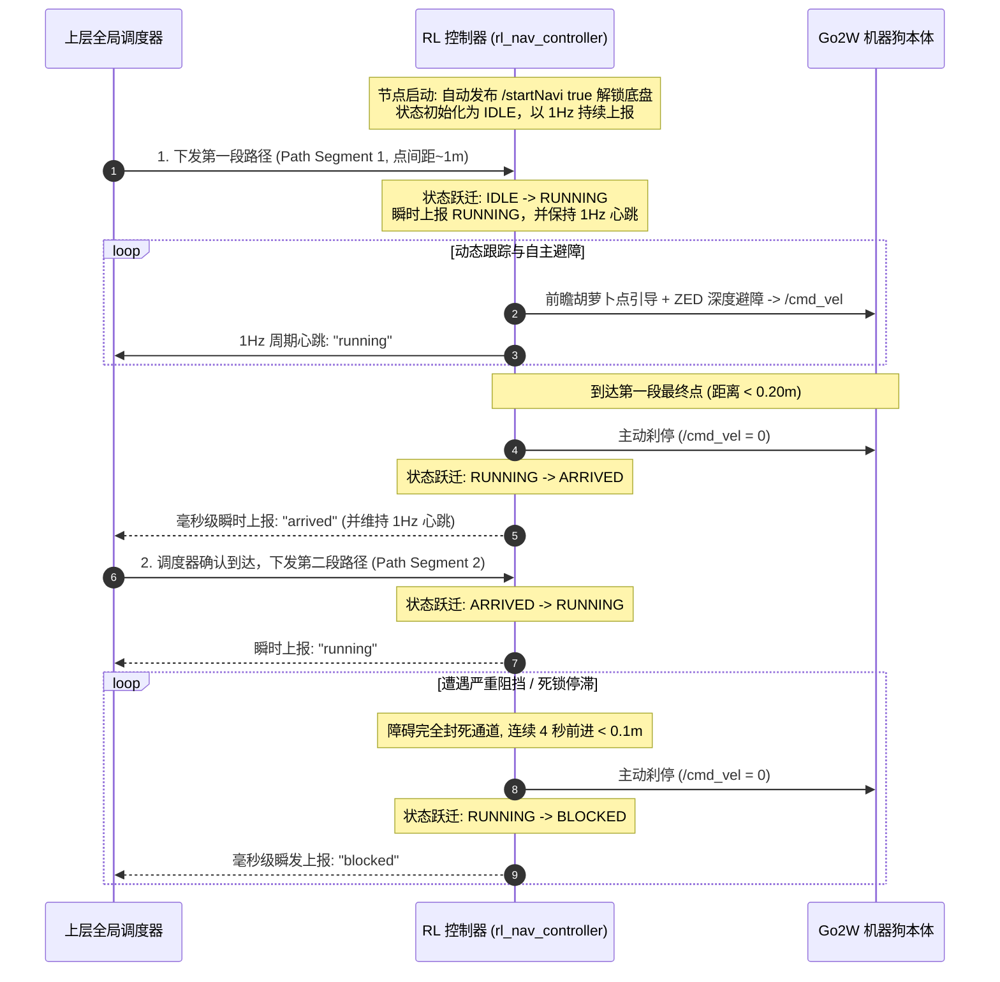
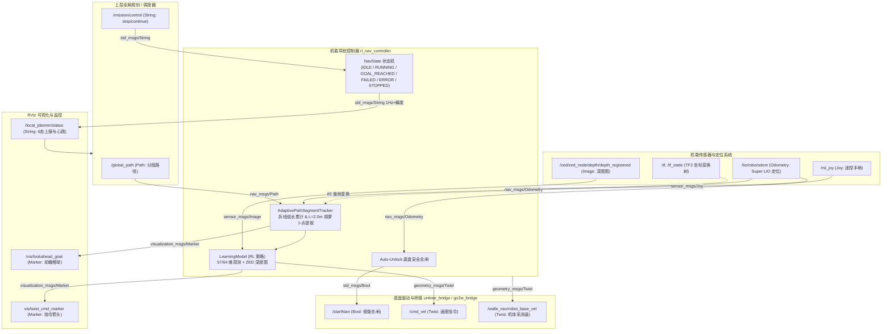
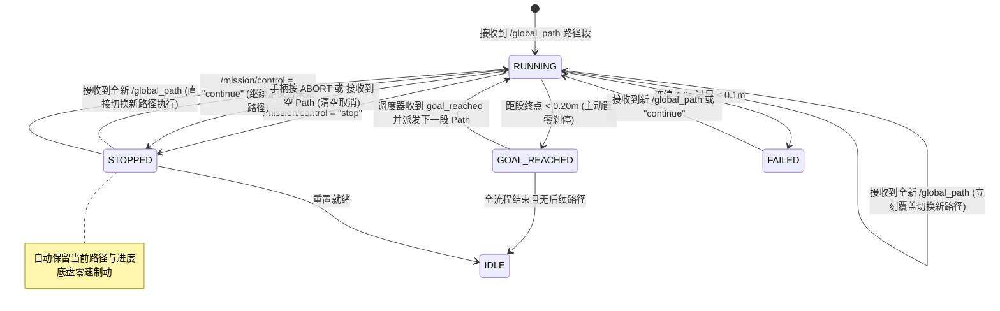
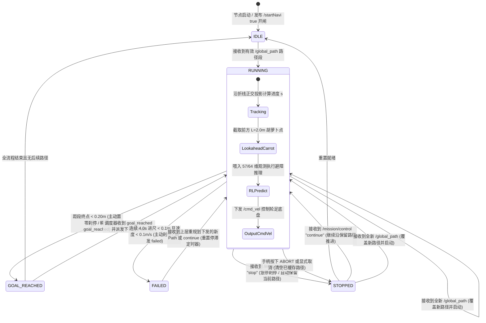

# 全局导航接口规范：模式对比与联合导航

> 合并自原 `GO2W_LOCAL_SRU_VS_GLOBAL_NAV_ARCHITECTURE.md` 与 `GLOBAL_NAV_INTEGRATION_SPEC.md`（v1.2）。
> 本文档以代码为准：`rl_nav_controller/rl_nav_controller/rl_nav_controller.py`、`adaptive_path_tracker.py`、`constants.py`、`start_nav.sh`。
> 已修正原 spec 中与代码不符的数值：心跳 1.0 Hz（非 3Hz）、到达阈值 0.20m（非 0.15m）、状态机 6 态（含 error）、路径跟踪器为 `adaptive_path_tracker.py`。

---

## 1. 架构概览与核心对齐原则

```
+--------------------------------------------------------------------------------------------------+
|                                    Unitree Go2W 统一控制基座                                      |
|                                                                                                  |
|   遥控手柄控制统一: [B 键] -> 紧急制动 / 暂停 (/motion_enabled=False)                              |
|                    [A 键] -> 开闸启动 / 恢复推进 (/motion_enabled=True)                             |
|                                                                                                  |
|   到达判定距离统一: 单点导航 ARRIVE_GOAL_THRESHOLD = 0.20m                                        |
|                    全局路径 SEGMENT_ARRIVE_THRESHOLD = 0.20m                                     |
+--------------------------------------------------------------------------------------------------+
                                        |
                 +----------------------+----------------------+
                 |                                             |
                 v                                             v
  【模式一：单独启动局部 SRU 测试】               【模式二：接入全局导航部署】
  • 适用：局部避障策略推理、单点直连导航         • 适用：长距离全自主巡航、跨楼层楼梯导航
  • 启动脚本：./start_local_sru.sh              • 启动脚本：./start_nav.sh
  • 目标来源：RViz 2D Nav Goal (/goal_pose)     • 目标来源：全局规划器动态下发 (/global_path)
  • 控制节点：rl_nav_controller                 • 控制节点：rl_nav_controller_stairs
```

---

## 2. 两种模式对比

### 2.1 模式一：单独启动局部 SRU 测试（`start_local_sru.sh`）

不依赖上层全局地图规划器与调度状态机，单独拉起底盘桥、雷达重定位、深度相机感知与机载 SRU 策略，用于快速验证：
- 策略网络的端到端动态避障敏捷度；
- 深度相机与激光雷达定位实时性；
- 遥控手柄 A/B 键即时启停与刹停保底；
- RViz 2D Nav Goal 单点目标响应与 0.20m 精准到点。

调用文件（机载路径）：

| 序号 | 文件/模块 | 路径位置 | 功能描述 |
| :--- | :--- | :--- | :--- |
| 1 | 启动主脚本 | `~/sru_ws/start_local_sru.sh`（兼容软链接 `start_go2w_system.sh`） | 自动加载环境、拉起后台支撑节点、最后前台启动避障策略 |
| 2 | 停止脚本 | `~/sru_ws/stop_local_sru.sh` | 向 `/motion_enabled` 发布 false 锁死底盘，终止所有后台节点 |
| 3 | 底盘与手柄桥 | `~/sru_ws/src/go2w_bridge/launch/go2w_bridge.launch.py`（或 `~/go2w_nav_ros2_ws/...`） | 拉起 `cmd_vel_bridge` 与 `wireless_controller`：B 键发布 `/motion_enabled=False`，A 键发布 `True`；仅使能时转发 `/cmd_vel` |
| 4 | 激光雷达与定位 | `livox_ros_driver2 msg_MID360_launch.py` & `super_lio map_localization.py`（源码在 `Super-LIO-ros2/src/super_lio`） | 驱动 MID-360 与 Super-LIO 重定位；前端发 `/lio/robo/odom`（world 系），收到 `/initialpose` 进入 TRACKING 后再发 `/loc/robo/odom`（map 系） |
| 5 | 深度相机感知 | `realsense2_camera rs_launch.py` 或 `zed_wrapper zed_camera.launch.py` | 输出原生深度图 |
| 6 | 相机覆盖配置 | `~/sru_ws/realsense_nav_override.yaml` 或 `~/sru_ws/zed_nav_override.yaml` | 移动避障优化的相机配置（空/时/空洞滤波，关闭点云与 RGB） |
| 7 | 相机静态 TF | `tf2_ros static_transform_publisher` | 发布 `base_link -> camera_link`（RealSense: `0.34, 0.0, 0.25`）水平外参 |
| 8 | 强化学习局部控制器 | `~/sru_ws/src/sru-robot-deployment/rl_nav_controller/rl_nav_controller/rl_nav_controller.py` | SRU 避障核心节点：读取深度图与里程计，接收单点目标推理 `cmd_vel`，到点 0.20m |
| 9 | 控制器常量 | `~/sru_ws/src/sru-robot-deployment/rl_nav_controller/rl_nav_controller/constants.py` | 定义 `ARRIVE_GOAL_THRESHOLD = 0.20m`、`BUTTON_START = 0`、`BUTTON_PAUSE = 1` 等 |
| 10 | 策略模型权重 | `~/sru_ws/model/Odin_nav_policy.onnx` | 机载端到端 ONNX 强化学习神经网络权重（文件名以实际部署为准，当前 canonical 为 `nav_policy.onnx`） |

### 2.2 模式二：接入全局导航全系统部署（`start_nav.sh`）

接入高层全局拓扑地图规划器、分段胡萝卜点自适应追踪、3D 楼梯坡度门控与全自主状态机调度，用于：
- 全局大范围自主导航巡航；
- 窄门、双向走廊穿行（`curvature_only` 转弯前瞻自适应，防止墙面误判）；
- 跨楼层上下楼梯感知与平滑推进；
- 逐段任务推进调度与停滞重规划上报（`/local_planner/status`）。

调用文件：

| 序号 | 文件/模块 | 路径位置 | 功能描述 |
| :--- | :--- | :--- | :--- |
| 1 | 全局启动主脚本 | `~/go2w_nav_ros2_ws/start_nav.sh` | 基于 tmux 动态分屏拉起多节点集群，按依赖顺序拉起驱动、SLAM、感知、全局规划与局部规划 |
| 2 | 全局停止脚本 | `~/go2w_nav_ros2_ws/stop_nav.sh` | 发布零速制动并 `/motion_enabled: false`，发送 C-c 并关闭 tmux 会话 |
| 3 | 雷达硬件驱动 | `livox_ros_driver2 msg_MID360_launch.py` | 独立后台驱动 MID-360 |
| 4 | 激光里程计与重定位 | `super_lio map_localization.py` | Super-LIO 定位节点：前端发布 `/lio/robo/odom`；收到 `/initialpose` 初始化后发布 `/loc/robo/odom`（`frame_id: map`）与动态 `map -> world` TF。未给初始位姿时停在 `WAIT_INIT`，这两项输出都不存在 |
| 5 | 深度相机节点 | `realsense2_camera rs_launch.py` 或 `zed_wrapper zed_camera.launch.py` | 后台运行深度相机节点 |
| 6 | 底盘与手柄安全桥 | `go2w_bridge/launch/go2w_bridge.launch.py` | 运行 `go2w_cmd_vel_bridge` 与 `go2w_wireless_controller`（B 刹停、A 恢复） |
| 7 | 全局规划器 | `global_planner/launch/global_planner.launch.py` | 基于 3D 点云栅格地图生成全局最优无碰撞路径，向 `/global_path` 逐段下发 |
| 8 | 楼梯感知局部控制器 | `src/rl_nav_controller/rl_nav_controller/rl_nav_controller_stairs.py` | 集成楼梯 3D 坡度门控（下坡 0.40m、上坡 0.45m 前瞻）、曲率前瞻自适应、终点航向对齐与状态机 |
| 9 | 几何路径追踪器 | `src/rl_nav_controller/rl_nav_controller/adaptive_path_tracker.py` | 计算当前投影进度、胡萝卜点插值、曲率估计与终点到达判定（`check_arrived`，阈值 0.20m） |
| 10 | 楼梯深度图处理器 | `src/rl_nav_controller/rl_nav_controller/stairs_depth_processor.py` | 楼梯斜坡点云与深度图重映射适配工具 |
| 11 | 核心避障基类 | `src/rl_nav_controller/rl_nav_controller/rl_nav_controller.py` & `rl_nav_controller_adaptive.py` | 底层推理引擎、TF 转换、手柄 A/B 恢复、底盘启闭安全总闸 |

### 2.3 关键特性对齐矩阵

| 关键特性 | 模式一：单独启动局部 SRU | 模式二：接入全局导航部署 | 对齐结果 |
| :--- | :--- | :--- | :--- |
| 启动命令 | `cd ~/sru_ws && ./start_local_sru.sh` | `cd ~/go2w_nav_ros2_ws && ./start_nav.sh` | 独立区分，清晰明确 |
| 停止命令 | `cd ~/sru_ws && ./stop_local_sru.sh` | `cd ~/go2w_nav_ros2_ws && ./stop_nav.sh` | 各自独立，互不污染 |
| 进程管理 | 后台 `nohup / &` + `trap cleanup` | `tmux` 动态分屏交互式多会话 | 适配不同使用场景 |
| 手柄遥控暂停 | 按 [B] 进入 `STOPPED`，制动停机，保留目标 | 按 [B] 进入 `STOPPED`，制动停机，保留路径 | 完全对齐 |
| 手柄遥控启动 | 按 [A] 开闸解禁，恢复向单点目标推进 | 按 [A] 开闸解禁，重对齐并恢复路径追踪 | 完全对齐 |
| 底盘硬件桥 | `go2w_bridge`（优先）/ `unitree_bridge`（兜底） | `go2w_bridge` | 统一使用 go2w_bridge |
| 底盘安全总闸 | `/motion_enabled` & `/startNavi` 联动 | `/motion_enabled` & `/startNavi` 联动 | 完全对齐 |
| 目标到达判定 | `arrive_goal_threshold = 0.20m` | `segment_arrive_threshold = 0.20m` | 完全对齐为 0.20m |
| 原地漂移容差 | `0.40m` | `0.40m` | 完全对齐 |
| 路径规划器 | 无（直连单点目标） | `global_planner` 自动全局路径生成 | 按需分层 |
| 楼梯/坡度感知 | 依赖纯深度图原生策略感知 | 动态 3D 路径坡度门控（下坡 0.4m / 上坡 0.45m） | 全局层增强 |
| 状态机上报 | 瞬发 `idle/running/goal_reached/stop` | 3Hz 周期 + 瞬发 `idle/running/arrived/blocked/stop` | 向下完全兼容 |

---

## 3. 业务交互模式：分段路径推进机制

上层调度与下层执行采用 **"分段下发、到点反馈、逐段推进"** 的交互闭环：



核心推进流程：
1. **单段下发**：上层规划器每次下发一段局域 Path（点间距约 1m）；
2. **平滑跟障**：下层利用动态前瞻胡萝卜点在段内平滑巡航，遇到障碍由 RL 策略自主绕行并自动收敛回本段路径；
3. **到点反馈**：当且仅当机器狗到达该段 Path 的**最终目标点**时，下层主动原地刹停，**立即瞬间上报状态**，同时保持低频心跳；
4. **推进下一段**：上层接收到本段到点反馈后，结合全局最新态势，下发下一段 Path。

---

## 4. 状态机设计与上报机制

### 4.1 状态枚举与 JSON 格式

状态机严格对齐 `local_planner_status_diagram` 标准规范，所有上报通过 `/local_planner/status` 以 JSON 字符串发布：`{"state": "<state>", "msgs": <array>}`。
各状态语义与字段定义如下（默认 `msgs` 为 JSON 原生数组：非 error 时为 `[]`，error 时为 `["zed_camera_lost"]`）：

| 状态值 (`state`) | 附带消息 (`msgs`) | 状态语义 | 触发条件与恢复策略 | 机体动作 |
| :--- | :--- | :--- | :--- | :--- |
| `"idle"` | `[]` | 空闲就绪 | 节点启动就绪、或已完成全流程且无路径任务。收到新路径直接跃迁至 `running` | 原地站立静止，等待新路径 |
| `"running"` | `[]` | 任务执行中 | 收到有效全局 Path、或在 `stopped` / `failed` 状态下收到 `resume` 指令恢复执行 | 按前瞻胡萝卜点推进，ZED 深度自主避障 |
| `"goal_reached"` | `[]` | 本段路径已到达 | 距离当前段 Path 的**最终目标点** < 0.20m。主动刹停置零速度，清除已完成目标，瞬发上报后立刻变至 `idle`，构成单向闭环三角（`idle -> running -> goal_reached -> idle`） | 主动刹停 |
| `"failed"` | `[]` | 规划受阻/死锁停滞 | 前方被障碍物完全封堵，连续停滞超时（默认 >4.0s）。**可恢复**：上层重发 `/global_path` 或发送 `resume` 即可脱困继续 | 主动减速刹停，避免顶撞障碍物，等待上层重规划 |
| `"error"` | `["zed_camera_lost"]` | 传感器/硬件致命异常 | ZED 相机深度帧连续中断超时（>2.0s）。**不可自动恢复**：此时下发新路径会被主动拒绝，需检查硬件连线或重启终端 | 主动减速刹停，拒绝接收新路径，等待重启/硬件恢复 |
| `"stopped"` | `[]` | 停止/暂停 | 收到上层指令 (`/mission/control: "pause"` 或 `"stop"`)、现场手柄按 ABORT、或收到空路径 | 原地紧急制动刹停，**自动在内存中保留未跑完路径**。停后收新路径仍保持 stopped（仅更新内存路径），只有收到 `"resume"` 才会重新启动 |

> **标准上报格式示例**：
> - 正常行走：`{"state":"running","msgs":[]}`
> - 本段到达：`{"state":"goal_reached","msgs":[]}`
> - 遇阻死锁：`{"state":"failed","msgs":[]}`
> - 相机掉线：`{"state":"error","msgs":["zed_camera_lost"]}`
>
> **参数化兼容模式**：控制器亦支持通过 `--status-msgs-format` 切换为 `string_brackets`（`"[]"` 与 `'["..."]'`）或 `empty_string`（`""`）。接收端工具对各种形态均实现无缝容错解析。
>
> **向后兼容别名**：代码内部 `NavState` 保留 `ARRIVED="goal_reached"`、`BLOCKED="failed"`、`STOP="stopped"`、`PAUSED="stopped"` 别名映射。

### 4.2 上报通信策略：1Hz 周期心跳 + 关键事件毫秒级瞬发

- **通信 QoS**：`/local_planner/status` 采用 `Reliability: RELIABLE` 与 `Durability: TRANSIENT_LOCAL`（depth=10），确保状态瞬发与突发切换均完整推入队列；
- **低频周期心跳（1Hz）**：若无状态切换，以 1Hz 频率周期性广播当前 JSON 状态；
  - 到达状态 (`"goal_reached"`) 在到点时瞬发上报一次后立刻变至 `idle`；在 `idle` 下以 1Hz 心跳广播并持续监听新路径，一旦收到新路径直接跃迁至 `running`；
- **事件驱动瞬发**：状态跃迁的当个控制循环瞬时立即发布，包括：
  1. 进入最终点 <0.20m 的瞬间 → 立即发布 `{"state":"goal_reached","msgs":[]}` 并立刻变至 `idle`；
  2. 进入 `idle` 后以 1Hz 广播心跳，持续监测新路径；
  3. 停滞超时的瞬间 → 立即发布 `{"state":"failed","msgs":[]}`；
  4. 相机掉线超时的瞬间 → 立即发布 `{"state":"error","msgs":["zed_camera_lost"]}`；
  5. 收到 `/mission/control: "pause"` 或 `"stop"` 的瞬间 → 立即发布 `{"state":"stopped","msgs":[]}`；
  6. 处于 `stopped` 下收到新路径 → 仅更新内存路径，保持 `stopped` 且不自启；
  7. 收到 `"resume"` / `"continue"` 或在非 stopped 状态下收到新路径启动的瞬间 → 立即发布 `{"state":"running","msgs":[]}`。

> **`stopped` 状态不变式（重要）**：`stopped` 是"暂停锁存"，按状态图它**只有一条出边**——显式恢复（手柄 A / `resume`）回到 `running`。
> - `stopped` **永远不会**自动变成 `failed`；`set_state()` 会直接拒绝 `stopped -> failed` 的跃迁并打印 `[NavState] Refused illegal transition`。
> - 底盘运动门（`/motion_enabled=False`，B 键）关闭期间，控制回路把停滞检测窗口持续重置，**不会**触发停滞超时（门关着本来就不该有位移）。
> - 暂停期间收到新 `/global_path` 或 `/goal_3d` 只更新内存中的目标/路径，保持 `stopped`。
> - 重复/回放的 `/motion_enabled=True`（两个 bridge 同一次 A 的重复消息）不会被当成恢复请求。

### 4.3 停滞遇阻判定机理（Blocked Detection）

- **监控指标**：沿路径累计推进弧长增量 Δs；机器狗物理地面测速 v_real = √(v_x² + v_y²)。
- **判定逻辑**：若当前状态处于 `RUNNING`，但由于前方障碍物过近（如 <0.4m）导致策略输出被安全抑制，连续 **4.0s**（可配置）内满足 Δs < 0.1m 且 v_real < 0.1m/s；触发 `FAILED` 状态，输出速度强制置零，上报 `{"state":"failed","msgs":[]}`，防止死磕障碍物，等待上层全局重规划（重发新路径或发送 resume 即可恢复）。

---

## 5. 全系统话题发布与订阅完整技术规格书

### 5.1 总体通信拓扑



### 5.2 接口分类一：上层规划调度对接接口

| 话题名称 (Topic) | 通信方向 | ROS 2 消息类型 | 频率 / 触发机制 | 对应的节点参数 (Parameter) | 字段定义与控制语义 |
| :--- | :---: | :--- | :--- | :--- | :--- |
| **`/global_path`** | 上层 → 控制器（控制器订阅） | `nav_msgs/msg/Path` | 每次下发一段局域路径时发布一次 | `path_topic`（默认 `"/global_path"`） | **分段全局路径输入**。`header.frame_id`：坐标系（推荐 `"world"` 或 `"map"`）；`header.stamp`：生成时间戳；`poses`：散点列表，每点 `PoseStamped`（position x/y/z 单位米；末点若包含朝向要求则填入有效四元数，否则沿路径切向自然停机）。**路径覆盖规则**：任何时刻（包括推进中或 `STOP` 停顿时）下发新路径，控制器立即切换至新路径执行 |
| **`/local_planner/status`** | 控制器 → 上层（控制器发布） | `std_msgs/msg/String` | 1Hz 固定周期心跳 + 状态跃迁毫秒级瞬发 | `status_topic`（默认 `"/local_planner/status"`） | **多状态生命周期上报（6 态）**。数据内容为字符串 (`msg.data`)，上层据此执行逐段推进判断：`"idle"` 空闲就绪等待新路径；`"running"` 正在沿路径推进或绕障；`"goal_reached"` 到达本段终点（<0.20m），速度已主动刹停，提示上层立刻派发下一段；`"failed"` 前方封死连续 4.0s 进尺 <0.1m，提示上层重规划；`"error"` 传感器/硬件致命异常；`"stopped"` 停止/暂停状态，底盘主动刹停，已自动保留当前路径 |
| **`/mission/control`** | 上层 → 控制器（控制器订阅） | `std_msgs/msg/String` | 事件触发（可选） | `stop_topic`（默认 `"/mission/control"`） | **任务启停控制指令**。`"stop"`：停止指令，底盘主动制动刹停（速度置零），状态变更为 `stopped`，系统默认自动保留当前未跑完的路径与进度；`"continue"`：继续推进，状态变更为 `running`，从当前位置继续沿保留路径无缝推进 |

> **关键认知纠偏**：上层只需向 `/global_path` 下发路径。控制器收到路径后，**下层控制器自己会把状态跃迁为 `running` 并通过 `/local_planner/status` 上报**！上层**不需要、也不能**发布名为 `running` 的话题。上层的正确逻辑是**单向监听 `/local_planner/status`**：
> - 监听到 `goal_reached` → 立即下发第 2 段 Path；
> - 监听到 `failed` → 触发全局绕路重规划；
> - 监听到 `stopped` → 处于暂停/停止状态；需要继续时发送 `/mission/control: "continue"`，或直接发送新 `/global_path` 覆盖执行。

#### 统一 STOP 状态与路径自动保留/覆盖流转机理

为了简化系统逻辑，下层**取消了原先 `paused` 与 `stop` 的多余区分，统一整合为 `stopped`**：

1. **自动保留当前路径（Path Retention by Default）**：当上层发布 `/mission/control: "stop"` 时，控制器执行紧急主动制动（速度置零），进入 `stopped` 状态；内部路径追踪器（`path_tracker`）**默认完整保留未跑完路径和进度弧长 s**，不予清除；后续上层只要发送 `/mission/control: "continue"`，状态自动恢复为 `running`，机器狗立刻从暂停点无缝继续跑完剩余路径。
2. **接收新路径自动覆盖（New Path Preemption & Override）**：无论机器人当前处于 `running` 推进中、还是 `stopped` 停止中、亦或是 `failed` 停滞中；一旦上层下发了新的 `/global_path`（或 `/goal_3d` 单目标），控制器**优先以最新目标为准**：载入新路径并重置进度（s=0）与停滞探测器，状态跃迁为 `running` 开始推进。
   **唯一例外——手动暂停锁存（manual pause latched）**：若暂停来自现场 B 键 / 底盘 `motion_enabled=False` / `/mission/control: "pause"`，且尚未按 A（或发送 `resume`）解除，则收到新目标时**只更新内存中的目标与路径并保持 `stopped`**，不会自启。否则底盘门（`joystick_control_`）仍关闭，机器狗无法移动，4.0s 后停滞检测会误报 `{"state":"failed"}`——这正是"按 B 停下后重新下发路径、未立刻按 A 就报 failed"的成因。
3. **彻底取消任务（Explicit Cancel）**：若现场手柄按下 ABORT 紧急取消键，或上层下发**空路径** (`Path(poses=[])`)，控制器将彻底清空路径缓存，刹停并保持在 `stopped` 状态。



### 5.3 接口分类二：底盘驱动与硬件网关接口

| 话题名称 (Topic) | 通信方向 | ROS 2 消息类型 | 频率 | 对应的节点参数 (Parameter) | 控制语义与保护机制 |
| :--- | :---: | :--- | :--- | :--- | :--- |
| **`/startNavi`** | 控制器 → 底盘桥（控制器发布） | `std_msgs/msg/Bool` | 事件触发 | `start_navi_topic`（默认 `"/startNavi"`）<br>`auto_unlock_bridge`（默认 `true`） | **底盘安全总闸开/闭**。`data: true`：开闸使能运动。控制器收到第 1 帧有效雷达里程计（`/lio/robo/odom`）后**全自动发布 `true` 解锁**，无需人工手动开闸；`data: false`：节点退出、异常中断或按 Ctrl+C 时**安全发布 `false` 锁死底盘** |
| **`/cmd_vel`**<br/>（兼旧版 `/path_manager/path_manager_ros/nav_vel`） | 控制器 → 底盘桥（控制器发布） | `geometry_msgs/msg/Twist` | 10Hz ~ 15Hz（与策略同步） | `cmd_vel_topic`（默认 `"/cmd_vel"`） | **轮足底盘运动速度指令**。`linear.x`：前进线速度，范围 [-1.0, 1.5] m/s；`linear.y`：横向侧移，范围 [-0.6, 0.6] m/s；`angular.z`：原地转向，范围 [-1.5, 1.5] rad/s；`linear.z = angular.x = angular.y = 0.0`。在 `STOPPED`、`GOAL_REACHED`、`FAILED` 状态下，控制器自动主动发布零速制动 |
| **`/walle_nav/robot_base_vel`** | 控制器 → 系统（控制器发布） | `geometry_msgs/msg/Twist` | 随里程计触发（~20Hz） | — | **机体坐标系（Base Frame）对地测速反馈**。将雷达里程计在世界系下的三维速度，利用四元数动态转换到当前机器狗机体坐标系下发布，供内部状态观测和外部监控 |

### 5.4 接口分类三：传感器感知与定位输入接口

| 话题名称 (Topic) | 通信方向 | ROS 2 消息类型 | 频率 | 来源硬件 / 算法 | 字段要求与作用说明 |
| :--- | :---: | :--- | :--- | :--- | :--- |
| **`/lio/robo/odom`**<br/>（映射前：`/dlio/odom_node/odom`） | SLAM → 控制器（控制器订阅） | `nav_msgs/msg/Odometry` | 10Hz ~ 50Hz | Livox MID-360 雷达 + Super LIO 重定位算法 | **高频机身物理位姿与测速输入**。`pose.pose.position`：机器狗在世界坐标系中的实时坐标 [x,y,z]；`pose.pose.orientation`：空间姿态四元数 [w,x,y,z]；`twist.twist`：对地空间线速度与角速度。若未收到本话题，控制器将保持在 Waiting for robot position 状态，底盘不开闸 |
| **`/loc/robo/odom`** | 地图定位 → 控制器（控制器额外订阅） | `nav_msgs/msg/Odometry` | 约 10Hz | `map_localization.py`（MapLoc） | **地图系（`map`）位姿**，`child_frame_id: base`。仅在收到 `/initialpose` 并进入 TRACKING 后发布；与 `/lio/robo/odom` 同时可用时，控制器在 `map` 系路径跟踪中优先使用它 |
| **`/zed/zed_node/depth/depth_registered`** | 相机 → 控制器（控制器订阅） | `sensor_msgs/msg/Image` | 15Hz（恒定） | ZED 2i 双目立体深度相机 | **局部环境深度图输入**。编码格式 `32FC1`（单通道 32 位浮点，单位米）；分辨率经轻量化配置缩放后输入 VAE 编码器（有效深度感知范围 0.25m ~ 10.0m） |
| **`/tf` & `/tf_static`** | 系统 TF 树 → 控制器（控制器监听） | `tf2_msgs/msg/TFMessage` | 持续广播 | `tf2_ros` 坐标变换树 | **坐标系自动对齐与标定**。相机水平外参：`base_link -> zed_camera_link` ([0.257, 0.0, 0.28, 0, 0, 0])；定位链路为 `map -> world`（`/initialpose` 初始化后由 MapLoc 动态发布）`-> base`（Super-LIO 前端发布）。`map` 不存在时 RViz 的 `Fixed Frame: map` 必然报错；局部模式的 `start_local_sru.sh` 会额外广播静态 `map -> world` 兜底 |
| **`/rsl_joy`** | 手柄 → 控制器（控制器订阅） | `sensor_msgs/msg/Joy` | 50Hz | 机载蓝牙 / 2.4G 遥控手柄 | **安全人工接管与冗余微调**。手柄推杆可直接叠加微调速度，手柄指定按键可随时执行紧急 ABORT 切断 |

### 5.5 接口分类四：RViz 可视化与算法调试接口

| 话题名称 (Topic) | 通信方向 | ROS 2 消息类型 | 频率 | 说明 |
| :--- | :---: | :--- | :--- | :--- |
| **`/vis/lookahead_goal`** | 控制器发布 | `visualization_msgs/msg/Marker` | 5Hz | **动态前瞻胡萝卜点标记**。亮橙色立体球体（直径 0.4m），直观指示 RL 网络当前正在追踪的前方引导点位置 |
| **`vis/twist_cmd_marker`** | 控制器发布 | `visualization_msgs/msg/Marker` | 10Hz | 当前速度控制指令矢量箭头 |
| **`vis/goal_vector_marker`** | 控制器发布 | `visualization_msgs/msg/Marker` | 10Hz | 目标点相对机身位置的绿色指示矢量 |
| **`vis/recorded_waypoints_marker`** | 控制器发布 | `visualization_msgs/msg/Marker` | 1Hz | 录制航点与历史轨迹球体标记 |
| **`/goal_pose`** | 控制器订阅/发布 | `geometry_msgs/msg/PoseStamped` | 事件触发 | 兼容老版本单目标点输入与 RViz 2D Nav Goal 目标交互 |

---

## 6. 坐标系与 TF 适配方案

上层规划器发布的 Path 坐标系可能不明确。下层控制器采取防错与自适应策略：

```mermaid
flowchart TD
    RecvPath[接收到 /global_path] --> CheckFrame{检查 Path.header.frame_id}

    CheckFrame -->|匹配机载里程计 (world / map)| DirectAccept[直接接收并转换为局部目标]

    CheckFrame -->|未指定或为空 ''| FallbackAccept[告警提示: 默认绑定至机载当前里程计系]

    CheckFrame -->|指定了外层未知 frame_id| TFLookup{查询 TF 树是否存在变换<br/>lookupTransform}

    TFLookup -->|存在 TF 变换| TransformPath[通过 tf2 将路径点坐标转换至机载 world 系]
    TFLookup -->|不存在 TF 变换| FatalError[打印高亮红色告警并在 /local_planner/status 上报 blocked/error]
```

对齐策略说明：
1. **参数化指定**：新增参数 `path_frame_id`（默认值 `""`，即自动匹配机载 SLAM 的 frame）；
2. **TF2 监听器集成**：在 `rl_nav_controller` 内部挂载 `tf2_ros.Buffer` 和 `TransformListener`。若上层下发的是 `"map"` 而机载是 `"world"`，且系统中广播了 `map -> world` 的 TF，控制器自动完成坐标变换；
3. **安全自检**：若上层下发的点坐标首点与当前机器狗物理坐标偏差超过 2.5m，控制器将抛出异常预警，防止坐标系错位导致底盘暴冲。

---

## 7. 底盘自动化解锁与免配置启动设计

以往调试时，终端拉起导航策略后，必须人为敲命令 `ros2 topic pub /startNavi std_msgs/msg/Bool "{data: true}" --once`。若遗漏，底盘硬件网关 `unitree_bridge` 会阻断一切 `/cmd_vel`。

**解决方案：节点初始化自动开闸**
1. **开机自投使能**：在导航节点检测到首次收到里程计 `/lio/robo/odom` 且环境感知初始化完毕后，由节点内置的 `self.start_nav_publisher` 自动向 `/startNavi` 发布 `{data: true}`；
2. **退出自闭保护**：在节点析构或捕捉到 `SIGINT`（Ctrl+C）时，自动向 `/startNavi` 发布 `{data: false}`，实现无人值守、即开即用、安全闭环。

---

## 8. 核心避障算法：动态前瞻胡萝卜点在分段推进中的应用

针对上层下发的单段路径（点间距约 1m），底层算法执行细节如下：

```
上层分段 Path:
P0 (起点,狗当前位) ------ P1 (1m) ------ P2 (2m 障碍物) ------ P3 (3m) ------ P4 (4m 终点)
                            ▲                            ▲
                            │                            │
                     [实际狗身位置]               [动态前瞻胡萝卜点 L=2.0m]
```

1. **段内巡航（L = 2.0m）**：即使本段内部的点间距仅为 0.5m 或 1.0m，RL 策略网络拿到的永远是沿路径前方 2.0m 的平滑虚拟点；避障网络始终处于大纵深舒适区间，横向侧偏避障敏捷，绝无"一顿一顿"的减速顿挫；
2. **终点收敛（Approach Terminal Goal）**：当胡萝卜点触达本段终点 P4 无法再向前延伸时，胡萝卜点锚定在 P4；随着狗身逐渐接近 P4，到点距离进入自然衰减。当 `||P_robot − P4|| ≤ 0.20m` 时，触发自然到点；
3. **刹停并跃迁**：速度平稳降至 0；立即触发取消目标（Cancel Goal）清空状态；**瞬间向 `/local_planner/status` 发布 `"goal_reached"`**，通知上层调度系统派发下一段。

---

## 9. ROS 2 节点参数与内部核心变量全清单

### 9.1 ROS 2 节点参数

| 参数名称 (Parameter Name) | 数据类型 | 默认值 | 作用与物理意义 |
| :--- | :--- | :--- | :--- |
| `path_topic` | string | `"/global_path"` | 上层分段全局路径订阅话题名 (`nav_msgs/msg/Path`) |
| `stop_topic` | string | `"/mission/control"` | 上层任务控制指令订阅话题名 (`std_msgs/msg/String`，接收 `"stop"`, `"continue"`) |
| `status_topic` | string | `"/local_planner/status"` | 控制器向外发布的多状态上报话题名 (`std_msgs/msg/String`，6 个状态) |
| `start_navi_topic` | string | `"/startNavi"` | 宇树底盘硬件网关安全使能开闸话题名 (`std_msgs/msg/Bool`) |
| `cmd_vel_topic` | string | `"/cmd_vel"` | 下发给底盘的运动速度话题名 (`geometry_msgs/msg/Twist`) |
| `auto_unlock_bridge` | bool | `true` | 开机自投使能：检测到首次里程计自动开闸，节点退出自动锁死底盘 |
| `lookahead_distance` | float | `2.0` | 动态前瞻胡萝卜点距离 L（米）。沿路径前方截取虚拟引导点 |
| `segment_arrive_threshold` | float | `0.20` | 本段最终目标点到达判定距离阈值（米）。<0.20m 触发刹停 |
| `blocked_timeout` | float | `4.0` | 停滞超时阈值（秒）。连续超时未进尺判定为 `FAILED` |
| `blocked_dist_threshold` | float | `0.1` | 停滞判定最小进尺增量阈值 Δs（米） |
| `blocked_vel_threshold` | float | `0.1` | 停滞判定机身最小物理测速阈值 v_real（米/秒） |
| `path_start_max_dist` | float | `2.5` | 路径首点安全校验最大允许偏差（米）。防坐标系错位暴冲 |
| `status_heartbeat_frequency` | float | `1.0` | 状态上报周期心跳频率（Hz）。默认 1Hz |
| `path_frame_id` | string | `""` | 强制指定的路径坐标系。为空时自动匹配机载 SLAM 当前坐标系 |

### 9.2 内部核心状态变量

| 变量名称 (Variable Name) | 类型 / 类 | 初始值 / 取值 | 功能与状态机角色 |
| :--- | :--- | :--- | :--- |
| `self.state` | `NavState` | `NavState.IDLE` | 当前导航状态机生命周期枚举 (`idle`, `running`, `goal_reached`, `failed`, `error`, `stopped`) |
| `self.path_tracker` | `AdaptivePathSegmentTracker` | 实例 | 单段折线路径跟踪器，计算当前沿线进度 s 与前瞻虚拟目标点 |
| `self.blocked_detector` | `BlockedDetector` | 实例 | 滑动时间窗口停滞探测器，监控 Δs 与地面物理测速 |
| `self.chassis_unlocked` | bool | `False` | 记录底盘硬件网关是否已解锁，避免重复触发 |
| `self.has_tf2` | bool | `True/False` | 环境是否具备 `tf2_ros` 运行时，自动切换 TF 查询与安全回退分支 |
| `self.target_pos_w` | list[3] | `None` | 当前控制循环（5Hz）实际喂入 RL 神经网络的高层目标三维坐标 |
| `self.target_yaw_w` | float | `None` | 终点姿态期望偏航角或折线切线偏航角（弧度） |

### 9.3 核心控制逻辑流程



#### 关键机制具体逻辑说明

1. **瞬发 + 心跳混合上报 (`set_state`)**：每次调用 `set_state(new_state)` 时，系统在修改状态变量的当个控制循环瞬时直接调用 `self.publish_status_message()` 将字符串发布到 `/local_planner/status`；独立后台定时器以固定 1Hz 频率调用 `self.publish_status_heartbeat()` 持续广播 `self.state.value`，网络丢包时亦能保持状态可测。
2. **前瞻胡萝卜点折线投影算法 (`AdaptivePathSegmentTracker`)**：接收到散点路径时，预计算各线段长度与累计弧长 S_total；每个控制步将机器狗物理坐标 P_robot(x,y) 正交投影至折线段上，得到当前进度弧长 s_curr；虚拟引导点取 s_target = s_curr + 2.0m 处的折线内插坐标；若 s_target ≥ S_total 则自动锚定至终点 P_end；终点判定采用欧氏距离：`||P_robot − P_end||_xy ≤ 0.20m`。
3. **连续停滞遇阻判定 (`BlockedDetector`)**：在 `RUNNING` 期间持续追踪时间窗口起点与参考弧长进度；若某时刻检测到弧长增量 Δs ≥ 0.1m 或机身对地测速 v_real ≥ 0.1m/s，立即滑动刷新时间窗口起点；仅当二者同时不达标且连续经过时长 Δt ≥ 4.0s 时，才判定为 `FAILED`。收到新路径立即调用 `reset()` 清空停滞状态。
4. **TF2 动态适配与异常拦截**：若 `Path.header.frame_id` 为空或匹配机载里程计坐标系（`world` / `map`），直接采用；若为其他未知坐标系且环境存在 TF2，自动查找 `target_frame <- source_frame` 变换对所有路径点逐点变换；若 TF 树断裂无变换，高亮打印致命错误并丢弃异常路径，绝不盲目下发；安全自检：若转换后的路径第一个点与机器狗当前坐标直线距离超过 2.5m，控制台打印安全告警，防范参考系错位。
5. **底盘开闭总闸自闭环 (`unlock_chassis` & `lock_chassis`)**：`odom_callback` 检测到首次收到有效里程计且 `auto_unlock_bridge == True` 时，自动向 `/startNavi` 发布 `{data: true}`；在节点析构 `destroy_node()` 与 `main()` 的 `finally` 异常保护块中，自动向 `/startNavi` 发布 `{data: false}`，实现零人工干预的启闭安全防护。

---

## 10. 待对齐查明的关键技术细节清单

| 序号 | 待对齐对接事项 | 当前代码暂定实现方案 | 建议讨论与确认方向 |
| :---: | :--- | :--- | :--- |
| 1 | Path 坐标系名称与 TF 广播 | 若为空则默认为机载 SLAM 坐标系（`world`/`map`）；若为外层 frame 则通过 TF2 转换。首点偏差 >2.5m 告警 | 请上层规划器明确输出的 `header.frame_id` 是什么？全局调度节点是否会向 TF 树广播 `map -> odom` 或 `map -> world` 变换？ |
| 2 | `FAILED` 状态后的重规划闭环 | 下层刹停置零速度并持续上报 `"failed"`，直到收到新 `/global_path` 自动恢复为 `RUNNING` | 确认上层业务逻辑：当上层接收到 `"failed"` 后，是自动触发全局避障绕路重规划下发新 Path 段，还是需要报警提示人工遥控接管？ |
| 3 | 单段 Path 的点密度与长度规划 | 下层按连续折线处理，支持任意点间距（无论 0.5m、1.0m 或 2.0m 均可平滑追踪插值） | 确认上层规划器下发的平均单段长度是多少米？（如每段 3~5 个点约 3~5 米，还是更长？）段与段之间的下发间隔时延容忍度是多少？ |
| 4 | `/mission/control` 启停与路径保留控制语义 | 发送 `"stop"` 触发急停刹停且状态设为 `STOPPED`（系统自动默认保留剩余路径）；发送 `"continue"` 恢复沿保留路径推进并进入 `RUNNING`。若在 `STOPPED` 或推进中接收到新 `/global_path`，直接覆盖切换新路径执行。手柄 ABORT 清空路径并进入 `STOPPED` | 已根据最新要求统一为 `/mission/control` (String) 和默认路径保留/新路径覆盖机制 |
| 5 | 终点朝向（Terminal Heading）需求 | 下层检查最后一点的四元数，若 norm > 0.5 且模型包含 heading 则在终点进行偏航对齐；若无四元数则沿路径切向自然停机。当前默认 tol = 0.26 rad（≈15°），死区补偿 P 控制，5.0s 超时 + 0.40m 漂移保护 | 确认上层下发的终点是否带有机器狗姿态朝向约束需求？（详见 `GO2W_NAVIGATION_SYSTEM_GUIDE.md` §三.5） |

---

## 11. 代码实现落地与新增变量/逻辑完全手册

本规范所定义的分段推进、多状态瞬发上报、动态胡萝卜点前瞻、停滞检测以及底盘自解锁能力已在 `sru-robot-deployment/go2w_nav_ros2_ws/src/rl_nav_controller` 源码中完整落地。

### 11.1 模块与文件变更清单

| 文件路径 | 变更类型 | 核心职责说明 |
| :--- | :--- | :--- |
| `rl_nav_controller/adaptive_path_tracker.py` | 新增（NEW） | 封装完备的 `NavState` 状态枚举、`AdaptivePathSegmentTracker` 折线累计弧长与动态胡萝卜点生成器、以及 `BlockedDetector` 连续停滞超时探测器 |
| `rl_nav_controller/rl_nav_controller.py` | 核心修改 | 挂载 `/global_path` 与 `/mission/control` 订阅器，新增 `/local_planner/status` 周期+瞬发发布器，挂载 TF2 监听器自适应转换坐标系，集成胡萝卜点导航与自动解锁底盘 `/startNavi` |
| `rl_nav_controller/constants.py` | 修改 | 新增全局导航相关的默认话题名称、前瞻距离、到达阈值、停滞超时及 RViz Marker ID 常量 |
| `rl_nav_controller/visualization.py` | 修改 | 新增 `publish_lookahead_goal_marker` 函数，以亮橙色立体球向 `/vis/lookahead_goal` 广播前瞻胡萝卜点 |
| `launch/rl_nav_controller.launch.py` | 修改 | 新增 launch 参数对外暴露接口，修正相机水平静态外参为 Go2W 专属标定参数 (`base_link -> zed_camera_link`: `[0.257, 0.0, 0.28]`) |
| `package.xml` | 修改 | 添加 `tf2_ros` 与 `tf2_geometry_msgs` 依赖声明 |
| `scripts/test_global_nav_integration.py` | 新增（TEST） | 涵盖状态枚举、折线前瞻、终点钳制、到点刹停、连续停滞判定、边界容错等核心单元与集成测试套件 |

### 11.2 核心控制逻辑流程

参见 §9.3 状态图。关键机制：
- **瞬发 + 心跳混合上报**：`set_state()` 瞬时发布 + 1Hz 后台心跳；
- **前瞻胡萝卜点折线投影**：正交投影 → s_curr → s_target = s_curr + 2.0m → 内插坐标；终点锚定；
- **连续停滞遇阻判定**：Δs < 0.1m 且 v_real < 0.1m/s 连续 4.0s → `FAILED`；
- **TF2 动态适配与异常拦截**：空/match → 直接采用；未知 frame → TF2 转换；无变换 → 高亮告警并丢弃；首点偏差 >2.5m → 安全告警；
- **底盘开闭总闸自闭环**：首次里程计 → 自动 `/startNavi true`；析构/异常 → 自动 `/startNavi false`。

### 11.3 自动化与交互仿真测试工具

- **启动命令**：`python3 scripts/mock_global_nav_tester.py`
- **一键双段推进**：`python3 scripts/mock_global_nav_tester.py --two-seg [--seg1-len 2.0] [--seg2-len 1.5]`
- **核心测试流程（选项 [6]）**：下发第 1 段（直行 2.0m）→ 等待进入 `RUNNING` 并到点监测 → 毫秒级捕获 `"goal_reached"` → 瞬发第 2 段（左转 1.5m）→ 追踪直至第 2 段顺利到达终点上报 `"goal_reached"`，验证分段连续派发能力的实时性与稳定性。
