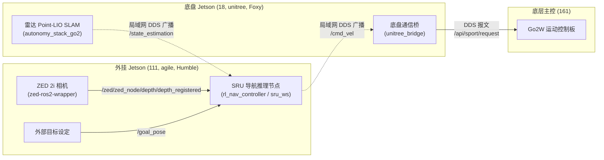

# Unitree Go2W 机器狗实机部署全景交接指南 (Robot Onboard Deployment Handover)

> **文档定位**：供新接手的 Agent 或工程师快速掌握本项目在 **Unitree Go2W 真实机器人** 上的软硬件拓扑、传感器接口、机载工程工作空间、话题映射及一键启动流程。  
> **更新时间**：2026-11-02  
> **当前状态**：双 Jetson 计算架构彻底理清，两机 ROS 2 DDS 透明组网畅通，ZED 2i 相机识别完毕，具备完整实机闭环条件。

---

## 目录
1. [机器狗双计算平台与网络拓扑](#1-机器狗双计算平台与网络拓扑)
2. [传感器与物理接口拓扑](#2-传感器与物理接口拓扑)
3. [机载工作空间与核心工程架构](#3-机载工作空间与核心工程架构)
4. [核心数据流与跨机 DDS 话题映射关系](#4-核心数据流与跨机-dds-话题映射关系)
5. [实机部署与闭环启动标准流程](#5-实机部署与闭环启动标准流程)
6. [关键常见问题与排坑备忘](#6-关键常见问题与排坑备忘)

---

## 1. 机器狗双计算平台与网络拓扑

全系统运行在同一个机载局域网（网段：`192.168.123.0/24`），外部连接可通过 **Agile-Robot-Guest WiFi**（`10.3.42.x/24`，当前最常用）或原有 `192.168.31.0/24` 网段接入。系统采用成熟的**高低层算力分离架构**：

| 节点 IP | 角色与硬件定位 | 操作系统与环境 | 登录方式 | 职能分工 |
| :--- | :--- | :--- | :--- | :--- |
| **`10.3.42.161`**<br/>(Agile-Robot-Guest WiFi)<br/>(机载网: `192.168.123.111`) | **高层视觉、雷达 SLAM 与强化学习核心脑**<br/>背部外挂 NVIDIA Jetson (Orin DevKit) | **Ubuntu 22.04 LTS**<br/>JetPack 6.x<br/>CUDA 12.x / Py3.10<br/>**ROS 2 Humble** | `ssh agile@10.3.42.161`<br/>(备选: `192.168.31.186` 或 `192.168.123.111`)<br/>密码：`agile` 或 `123` | **高层算法主战场（可单机跑全套）**。<br/>直连 ZED 2i 深度相机与 Livox MID-360 雷达，运行 `super_lio` 重定位与 `rl_nav_controller` 导航策略，输出 `/cmd_vel`。 |
| **`192.168.123.18`** | **底盘机载主脑**<br/>腹部原装 NVIDIA Jetson Orin NX (16GB) | **Ubuntu 20.04.5 LTS**<br/>JetPack 5.1.1 (L4T 35.3.1)<br/>CUDA 11.8<br/>**ROS 2 Foxy** | `ssh unitree@192.168.123.18`<br/>密码：`123` | **底层与原厂中枢**。<br/>运行 `unitree_bridge` 监听 `/cmd_vel` 并下发给运动控制板（若开机自启则无需登录）。 |
| **`192.168.123.161`** | **底层运动控制主板**<br/>宇树原装底层控制器 (CM4/MCU) | 宇树嵌入式 Linux | `ssh unitree@192.168.123.161`<br/>密码：`123` | 接收 `/api/sport/request` DDS 报文，驱动腿部 12 关节与 4 轮毂电机做运动学解算与步态控制。 |
| **`192.168.123.1`** | **车载路由器 / 外接网关** | 嵌入式网关 | `192.168.123.1` | 提供 WiFi AP 热点，连接外部笔记本电脑与所有机载设备。 |
| **`192.168.123.138`** | **外部调试笔记本 (PC)** | Ubuntu 22.04 (开发主机) | 本机终端 | 算法开发、训练、模型导出与远程 RViz 地图点击发点。 |

---

## 2. 传感器与物理接口拓扑

```
[Stereolabs ZED 2i 双目相机] ──USB 3.0──┐
                                       ├──> [高层核心算力脑 (192.168.123.111, agile)]
[Livox MID-360 激光雷达]   ──以太网───┘     │ (ROS 2 话题 /cmd_vel)
                                            ▼
                                   [底盘机载主脑 (192.168.123.18) 或 111 本地 bridge]
                                            │ (DDS 发送 /api/sport/request)
                                            ▼
                                   [底层运动主控板 (192.168.123.161)]
```

### 物理设备节点确认：
* **ZED 2i 双目深度相机**：
  * 物理插口：插在外挂 Jetson（`111`）的 USB 3.0 接口。
  * USB 识别符：`ID 2b03:f880`（Video 复合设备）、`ID 2b03:f881`（内部 IMU MCU）。
  * 驱动环境：在 `111` 上的 ROS 2 Humble 环境下启动。
* **激光雷达 (LiDAR)**：
  * 物理接线：通过机载交换机直连，在 `18` 上运行，高频实时广播 `/lio_sam_ros2/mapping/odometry`。
* **两机通信协议**：
  * 依赖标准的 ROS 2 CycloneDDS 组网，无需显式桥接，话题天然在全网互通。

---

## 3. 机载工作空间与核心工程架构

### 3.1 高层机载主机（`192.168.123.111`, user: `agile`）
位于 `/home/agile/`（已在本地开发机备份至 `/home/yichangfeng/go2w_robot_ref/jetson_111/`）：

```
/home/agile/
├── sru_ws/                      # SRU 端到端强化学习导航专项工作空间 (ROS 2 Humble)
│   └── src/                     # 包含 Humble 适配版的 rl_nav_controller
├── bridge_ws/                   # 通用底盘桥与导航接口工作空间
├── realworld/                   # 实机路试、Waypoints 与场景配置脚本
├── onnxruntime_gpu-1.19.0-cp310-cp310-linux_aarch64.whl  # Py3.10 GPU 推理加速包
└── unitree_ros2/                # 宇树官方 ROS 2 消息定义与环境配置脚本 (setup.sh)
```

### 3.2 底盘机载主机（`192.168.123.18`, user: `unitree`）
位于 `/home/unitree/`（已在本地开发机备份至 `/home/yichangfeng/go2w_robot_ref/`）：

```
/home/unitree/
├── bridge_ws/
│   └── src/unitree_bridge/      # C++ 底盘桥接节点：订阅 /cmd_vel -> 转发 /api/sport/request
├── autonomy_stack_go2/          # 雷达建图与 LIO-SAM 里程计定位
└── unitree_sdk2/                # 宇树底层 DDS 通信 SDK
```

---

## 4. 核心数据流与跨机 DDS 话题映射关系



---

## 5. 实机部署与闭环启动标准流程

> [!CAUTION]
> **安全铁则**：
> 首次测试电机关节运动前，**必须使用支架/板凳撑起机器狗腹部，使四腿完全悬空离地**！绝对不要在没有确认转向与急停有效前直接着地。

### 第一步：检查并启动底盘控制桥 unitree_bridge
先在 `111` 检查底盘桥是否已开机自启：
```bash
ssh agile@192.168.123.111
ros2 node list | grep unitree_bridge
```
- 若已自启：直接跳过本步！
- 若未自启：在 `111`（或 `18`）终端执行启动：
```bash
source /opt/ros/humble/setup.bash
source ~/unitree_ros2/setup.sh
source ~/bridge_ws/install/setup.bash
ros2 run unitree_bridge unitree_bridge
```

### 第二步：在高层机（`111`）启动雷达 SLAM、相机与策略

1. **终端 A：启动 Livox MID-360 雷达驱动与 Super LIO 重定位**
```bash
ssh agile@192.168.123.111
source /opt/ros/humble/setup.bash
source ~/bridge_ws/install/setup.bash
ros2 launch super_lio relocation.py rviz:=false
```

2. **终端 B：启动 ZED 2i 双目深度相机**
```bash
ssh agile@192.168.123.111
source /opt/ros/humble/setup.bash
source ~/bridge_ws/install/setup.bash 2>/dev/null || source ~/sru_ws/install/setup.bash
ros2 launch zed_wrapper zed_camera.launch.py camera_model:=zed2i
```

3. **终端 C：发布静态相机 TF**
```bash
ssh agile@192.168.123.111
source /opt/ros/humble/setup.bash
ros2 run tf2_ros static_transform_publisher 0.257 0.0 0.28 0.0 0.0 0.0 base_link zed_camera_link
```

4. **终端 D：启动 SRU 强化学习避障导航策略**
```bash
ssh agile@192.168.123.111
source /opt/ros/humble/setup.bash
source ~/unitree_ros2/setup.sh
source ~/sru_ws/install/setup.bash 2>/dev/null || source ~/bridge_ws/install/setup.bash

ros2 run rl_nav_controller rl_nav_controller \
  --ros-args \
  -r /dlio/odom_node/odom:=/lio/robo/odom \
  -r /path_manager/path_manager_ros/nav_vel:=/cmd_vel
```

### 第三步：发布使能信号与测试目标点（在任意机器或外部 PC）
```bash
# 1. 激活底盘导航控制开关（必须发布，否则 unitree_bridge 默认不输出运动）
ros2 topic pub /startNavi std_msgs/msg/Bool "{data: true}" --once

# 2. 监控速度指令输出
ros2 topic echo /cmd_vel

# 3. 悬空状态下发布一个前方 1.0 米的测试目标点
ros2 topic pub /goal_pose geometry_msgs/PoseStamped \
  "{header: {frame_id: 'odom'}, pose: {position: {x: 1.0, y: 0.0, z: 0.0}, orientation: {w: 1.0}}}" --once
```

> **完整纯命令行执行手册**：参见 [GO2W_ROS2_CLI_DEPLOYMENT_GUIDE.md](file:///home/yichangfeng/sru-navigation-learning/GO2W_ROS2_CLI_DEPLOYMENT_GUIDE.md)。

---

## 6. 关键常见问题与排坑备忘

1. **跨机 ROS 2 话题发现（DDS）**：
   * 两机需使用相同的 `ROS_DOMAIN_ID`（默认未设置时均为 `0`）。
   * `111` 终端必须先执行 `source unitree_ros2/setup.sh`，以加载宇树专用 DDS 接口和 QoS 配置。
2. **模型热替换流程**：
   * 将在 IsaacLab 训练好的最新权重（如 `model_1999.pt`）导出为 `nav_policy.onnx`。
   * 通过 scp 直接上传覆盖到 `111` 上的策略目录：
     `scp nav_policy.onnx agile@192.168.123.111:~/sru_ws/src/rl_nav_controller/deployment_policies/`
3. **GPU 硬件加速推理验证**：
   * 在 `111` 的 Python 环境中验证 ONNX Runtime 是否启用了 CUDA EP：
     `python3 -c "import onnxruntime as ort; print(ort.get_available_providers())"`
     应包含 `['CUDAExecutionProvider', 'CPUExecutionProvider']`。
